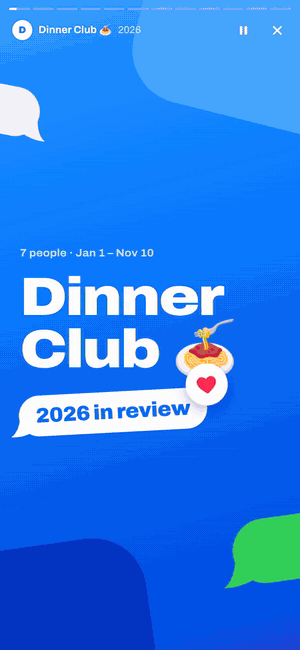
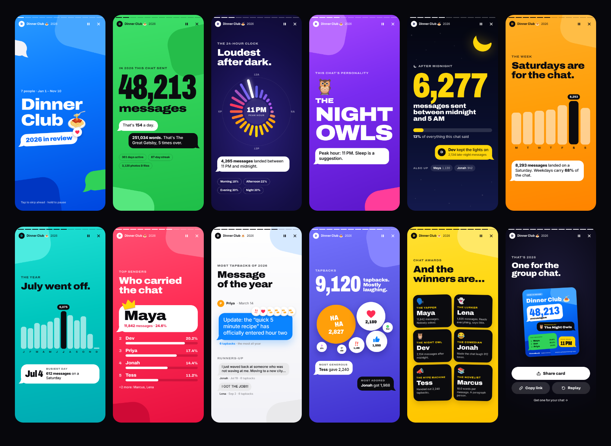
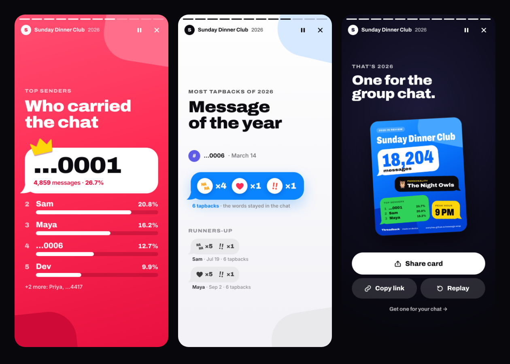
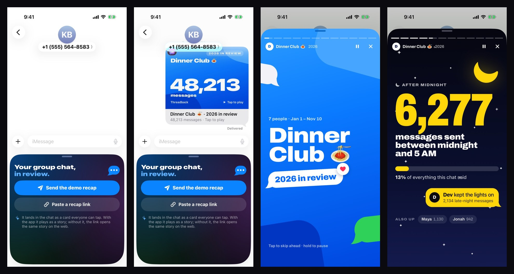

# Threadback

**Your group chat's year in review.** Like Spotify Wrapped, for iMessage group chats: someone
types `/wrapped`, the recap arrives in the thread, and everyone taps through the same story.

<p align="center">
  
</p>



Every name, number and message in this repository is invented. The full recording is
[docs/media/demo-story.mp4](docs/media/demo-story.mp4).

## What you get

A tap-through story, in the style of Instagram or Spotify stories, built from one group chat:

- how many messages, words and photos, and the longest streak
- activity by hour, weekday and month, and the busiest single day
- the chat's **personality**, from when it is most alive ("The Night Owls")
- who was up after midnight
- who carried the conversation
- the **message of the year**, picked by tapbacks
- **chat awards** (The Yapper, The Lurker, The Hype Machine…)
- a summary card to save or share

## Try it

The site is live: **https://averyhsu.github.io/imessage-wrap/**

| | What | Needs |
|---|------|-------|
| **[Watch the demo](https://averyhsu.github.io/imessage-wrap/?demo=1)** | The full story with an invented chat. | A browser. |
| **[Get the Mac app](https://averyhsu.github.io/imessage-wrap/mac/)** | The main way to use it. One person in the chat turns it on for that chat once; after that anyone in the chat types `/wrapped` and that Mac replies in the thread with a recap card, a short summary and the link to the story. Set up by clicking: no Terminal. | A Mac (macOS 14 or later) signed in to Messages, awake when someone asks. The app is not signed through Apple's paid program, so the first open takes one detour through System Settings; the page walks you through it. |
| **[Make one in the browser](https://averyhsu.github.io/imessage-wrap/make/)** | Drop in your Messages database (from a Mac, or from an iPhone backup on a Mac or PC), pick a chat, get a link to send. | A computer that has your messages. Nothing is installed or uploaded. |
| **iPhone app** | Threadback in the Messages app drawer: send a recap someone made as a card, and play it inside Messages. It does not make recaps itself (see below for why). | Xcode today; TestFlight would need Apple's paid developer program. [Guide](ios/README.md) |

There is also a command-line version of the Mac helper for people who prefer Terminal
([guide](docs/MAC.md)).

To run the pages on your own computer instead:

```sh
git clone https://github.com/averyhsu/imessage-wrap
cd imessage-wrap
npm ci && npm run serve
# demo story:     http://127.0.0.1:4173/?demo=1
# make your own:  http://127.0.0.1:4173/make/   (has a "Try it with sample data" button)
```

Everyone *else* in the chat needs nothing at all: the link opens in any phone's browser,
iPhone or Android. In a chat with green bubbles, or wherever Messages shows no preview, it
arrives as a long plain link; it still opens the same story.

A recap made with the defaults shows first names, shows people who are not in your contacts
as `…1234` until you name them, and leaves the words of messages out. The pictures above
are the invented demo with names and quotes switched on; this is an invented recap with the
defaults, before anyone has been named:



With the iPhone app, the recap also lives in the Messages app drawer. These are from the
real Messages app in the iOS Simulator, driven by the test suite
([all screenshots and a recording](docs/screenshots/ios/)):



## Where your messages go: nowhere

- **Counted on your device.** The Mac app, the browser page and the command-line tool all
  read your history locally. There is no server and no account; the site is a folder of
  static files.
- **The link is the recap.** The numbers are compressed into the part of the link after the
  `#`, which browsers never send to any website.
- **What a link contains:** counts, first names, the chat's name, and nothing else, unless
  you switch on quotes. People who are not in your contacts appear as `…1234`, never as a
  full phone number. The words of the three most-reacted messages are added only if you ask.
- **No tracking.** No analytics, cookies or third-party scripts. A content security policy
  stops the pages from contacting anything but their own files.
- Anyone holding a link can read that recap, so share it the way you would share a screenshot.

## Why it works this way

Apple gives apps no way to read your message history on an iPhone, and an app inside
Messages can only see the one message you tapped. So no single app can do the whole job.
Threadback splits it:

1. **One person computes the recap** where the history can be read: on a Mac
   (`~/Library/Messages/chat.db`), with the Mac app, in the browser or with the
   command-line tool; or from an iPhone backup in the browser. Messages has no way to add a
   command either, so `/wrapped` is that person's Mac noticing the word and answering. With
   only an iPhone there is one possible route, through Apple's Shortcuts app; it is written
   up as an [experiment](docs/SHORTCUT.md) and has not been run on a real phone yet.
2. **The recap travels as a link.** No backend, nothing to keep running.
3. **Everyone watches the same story**, in the browser, or natively in the Messages app
   drawer with the iPhone app.

Eleven possible routes were researched and scored before this one was chosen. The reasoning
is in [docs/DECISIONS.md](docs/DECISIONS.md) and the notes behind it in
[docs/research/](docs/research/).

## What is proven and what is not

Almost everything was built and tested without a real iPhone or Mac at hand: on Linux, and
on GitHub's macOS runners for the Apple parts. The one exception is the Mac app, which its
owner set up by clicking on their own Mac and which answered `/wrapped` in a real group
chat. That is one Mac on one version of macOS. The web pages pass their tests in Chromium,
in WebKit (the engine behind Safari) and in Firefox, but nobody has yet opened a recap in
Safari on a real iPhone. [STATUS.md](STATUS.md) lists exactly what has been seen working,
what has only been tested against invented data, and short checks for the things only a
real device can confirm.

## For developers

```
web/            the story player and landing page (plain HTML/CSS/JS, no build step)
web/make/       the in-browser maker: SQLite in WebAssembly + the JavaScript stats engine
wrapped/        the Python stats engine and command-line tool
wrapped/mac/    the command-line Mac helper the app grew out of (Python)
mac/            the Mac app: a menu-bar app that answers /wrapped (Swift; project made by XcodeGen)
ios/            the iPhone app and its Messages extension (Swift; project made by XcodeGen)
tests/          unit, conformance and end-to-end tests; invented fixtures built at test time
docs/           the shared contract (SCHEMA.md), decisions, research, guides, screenshots
```

Two engines (Python and JavaScript) compute the stats and must agree byte for byte; the
contract they both follow is [docs/SCHEMA.md](docs/SCHEMA.md).

```sh
npm ci
npm test                                   # story unit tests
node --test tests/engine-js/*.test.js      # JavaScript engine
python3 -m pytest tests/python tests/conformance tests/mac -q
npm run test:e2e                           # the story in a real browser (Playwright)
npm run test:make                          # the maker page, end to end
```

The browser suites write their screenshots to a temporary folder. `npm run shots:make`
refreshes the committed ones in `docs/screenshots/web/`.

The command-line tool, on a Mac:

```sh
pip install .            # or: curl -fsSL …/install.sh | bash   (see docs/MAC.md)
wrapped chats            # list your group chats
wrapped link "Dinner Club" --year 2026     # print the recap link; add --quotes to include message text
```

CI runs on every push: the web story, the maker and the Mac guide page in Chromium, WebKit
and Firefox (`BROWSER=webkit npm run test:e2e` picks one), both stats engines on Linux and macOS
(including a check against text archived by Apple's own code), the Mac app and the
command-line helper on macOS, and the iPhone app in the iOS Simulator. A push to `main`
that changes `web/` republishes the site, and one that changes the Mac app publishes a new
download on the [Releases page](https://github.com/averyhsu/imessage-wrap/releases).

## Names and trademarks

Threadback is an independent project and its source is public here. No licence has been
chosen yet (see [STATUS.md](STATUS.md)). It is not affiliated with, sponsored by
or endorsed by Apple or Spotify. iMessage is a trademark of Apple Inc.; Spotify Wrapped is a
trademark of Spotify AB. They are mentioned only to describe what this project works with
and what it resembles.
