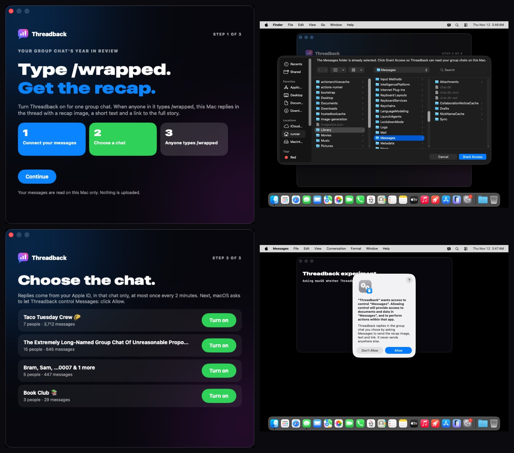

# Threadback for Mac: can `/wrapped` be a few-click setup?

**Short answer: yes, the setup can be about ten clicks with no typing, no Terminal and no
trip to System Settings.** It needs a real Mac app instead of the command-line helper, and,
for strangers, Apple's paid developer program. One risk remains that setup cannot fix:
whether macOS lets an app send into a group chat reliably. A working prototype of the app
exists; two short tests on a real Mac decide the rest.

This page is the summary. The evidence is in
[research note 07](research/07-mac-app-permission-floor.md) (permissions),
[note 08](research/08-mac-one-click-distribution.md) (ways to ship it) and the prototype in
[`mac/`](../mac/), with screenshots in [`screenshots/mac/`](screenshots/mac/).

## What setup would look like

For someone who has never opened Terminal, with a signed and notarized app:

| # | What they do | Who asks |
|---|--------------|----------|
| 1 | Click **Download** on the site | us |
| 2 | Open the download | macOS |
| 3 | Drag Threadback to Applications (or accept "Move to Applications") | us |
| 4 | Double-click Threadback | – |
| 5 | Click **Open** on "downloaded from the Internet" | macOS |
| 6 | Click **Continue** on the welcome screen | us |
| 7 | Click **Grant Access** in a file window that already shows the Messages folder | macOS |
| 8 | Click **Allow** so people show by first name (optional) | macOS |
| 9 | Click **Turn on** next to one group chat | us |
| 10 | Click **Allow** when macOS asks whether Threadback may control Messages | macOS |

After that, anyone in the chat types `/wrapped` and the Mac answers. Steps 5, 7, 8 and 10
are macOS's own prompts; no app can remove them. Everything else in today's guide goes
away: Terminal, the install command, Full Disk Access, typing chat names.

**Why there is no Full Disk Access step.** When a person picks the Messages folder in the
standard Open window, macOS treats that as consent for that one folder. Two shipping apps
set themselves up this way, and Apple's engineers describe the rule. Full Disk Access stays
as a fallback only.

## What exists now

A prototype menu-bar app, built and driven on GitHub's Mac runners (macOS 26):

- A normal double-clickable app, 2.7 MB, for both Apple and Intel chips.
- It reuses the existing counting code unchanged. On five invented chats its numbers are
  byte-for-byte the same as the command-line tool's, and its text reply is identical.
- The three setup screens above are real and photographed, including the Messages folder
  window with its "Grant Access" button and macOS's own "Threadback wants access to control
  Messages" prompt.
- It follows the helper's safety rules: replies only in chats you turned on, at most once
  every two minutes, never to old messages or its own, and it checks every send.
- It cannot send anything in CI, by design.

All chats in these pictures are invented.

## What is not proven

1. **The folder pick on a real Mac.** GitHub's runners have macOS's file protection switched
   off, so the test there could not fail and proves nothing either way. The claim rests on
   Apple's statements and on other apps doing it.
2. **Sending into a group chat.** On macOS 26, scripted sends to group chats sometimes
   report success and deliver nothing, and no fix was found in later versions. The prototype
   checks every send; if one does not arrive it would fall back to a notification that
   opens a ready-to-send message for you to send by hand. On an affected Mac, `/wrapped`
   would then need you at the keyboard.
3. **Staying granted** across restarts and app updates.

## Two tests on your Mac (about two minutes each)

Get the prototype: on GitHub, open **Actions → Mac app → the latest green run → Artifacts →
`mac-app`**, and unzip `Threadback-debug-with-probes.zip`. Because this build is not
notarized, the first launch needs System Settings → Privacy & Security → **Open Anyway**.

**A. Can it read your messages after one folder pick?**
1. Check that Threadback is *not* listed under Privacy & Security → Full Disk Access.
2. Open Threadback, click **Continue**, **Connect Messages…**, **Grant Access**.
3. Pass: it says "Connected" and shows your real group chats with plausible counts.
4. Quit, restart the Mac, open it again. Pass: still connected.

**B. Does a reply arrive?** This sends real messages into the chat you choose.
1. Pick a small chat whose members will not mind. Click **Turn on**, then **Allow**.
2. From your phone, type `/wrapped` in that chat.
3. Pass: an image, a short text and a link arrive, and the menu-bar item does not say
   "not confirmed".

If A passes, the few-click setup is real. If B passes on your macOS version, so is the
whole feature. If B fails, the app still works with one tap from you per reply.

## What it takes to ship

| Need | Detail | Cost |
|------|--------|------|
| Apple Developer Program | Signs and notarizes the Mac app so it opens with one click. The same membership covers TestFlight for the iPhone app. Your legal name appears as the developer. First approval can take a few days. | $99 a year |
| Finish the app | Roughly two weeks of work from the prototype: the send fallback, reconnecting when access is lost, settings for several chats, automatic updates, testing on clean Macs. | – |
| A download page and releases | A page on the site and builds on GitHub Releases. This is a new public download. | Free |

Without the developer program there is a free route: one pasted Terminal command that
installs the same app, after which setup is the same clicks as above. It still means opening
Terminal once, and macOS forgets the app's permissions on every update.

Not possible: the Mac App Store (Apple rarely approves apps that control Messages), and
any route with nothing to install.

## Decisions for you

1. Run tests A and B, or say you would rather not.
2. Whether to join the Apple Developer Program ($99 a year).
3. Whether to build the prototype into the finished app and make it the main way in.
