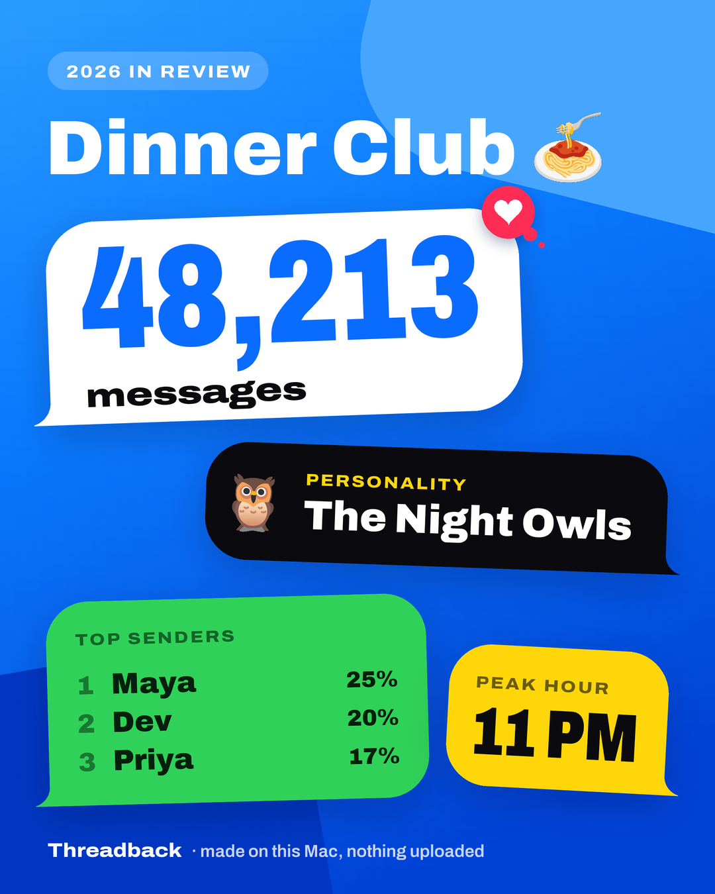

# The Mac helper: type `/wrapped`, get the recap in the thread

If one person in a group chat runs this small helper on their Mac, **anyone** in that chat can
type `/wrapped` and the recap appears right there in the conversation:

1. a recap image (the card below),
2. a short text recap,
3. a link that opens the animated story for every member, on any phone.



Everything is computed on your Mac from your own Messages history. Nothing is uploaded.

> **Honest status.** The helper is tested end to end *except for the last step*: handing a
> message to the Messages app. That step cannot be tested without a real Mac that is signed in
> to iMessage, and on macOS 26 and 27 it is known to be fragile for group chats (see
> [Limits](#limits)). The [2-minute checklist](#the-2-minute-real-mac-checklist) below is how
> you find out whether it works on your Mac. See [What has been tested](#what-has-been-tested).

## What you need

- A Mac that is signed in to Messages (iMessage), and stays awake while the helper runs.
- macOS with Python 3.9 or newer. Every Mac has it once Apple's free "Command Line Tools" are
  installed; the installer explains how if they are missing.
- About two minutes for the two permissions macOS will ask for.

## 1. Install

Open the **Terminal** app and paste:

```sh
curl -fsSL https://raw.githubusercontent.com/averyhsu/imessage-wrap/main/install.sh | bash
```

It creates a private folder (`~/.threadback`), installs Threadback and the Pillow imaging
library into it, and adds two commands, `threadback` and `wrapped` (the same thing under two
names), to `~/.local/bin`. It uses no `sudo`, changes nothing system-wide, and sends nothing.
If it says `~/.local/bin` is not on your PATH, run the one line it prints.

<details>
<summary>Installing before this branch is merged into <code>main</code></summary>

```sh
curl -fsSL https://raw.githubusercontent.com/averyhsu/imessage-wrap/claude/imessage-wrapped-build-84gdoo/install.sh \
  | THREADBACK_REF=claude/imessage-wrapped-build-84gdoo bash
```
</details>

To remove it again: `curl -fsSL https://raw.githubusercontent.com/averyhsu/imessage-wrap/main/install.sh | bash -s -- --uninstall`

## 2. Let your terminal read your messages (Full Disk Access)

macOS protects the Messages database. The app you type commands in needs permission once:

1. Open **System Settings > Privacy & Security > Full Disk Access**.
2. Turn it on for **Terminal** (or iTerm, or whichever app you use). Use **+** if it is not listed.
3. **Quit that app completely and open it again.**

Check that it worked. This reads, and sends nothing:

```sh
threadback doctor
threadback chats
```

`doctor` should say `can read ... chat.db`, and `chats` lists your group chats with their names.

Full Disk Access is a broad permission: it lets that terminal app (and anything you run in it)
read protected files on your Mac. Threadback itself only opens the Messages database and your
address book (for names), read-only.

## 3. Look before you send: preview and dry run

Pick a chat (part of its name is enough) and look at exactly what would be sent:

```sh
threadback preview --chat "Dinner Club" --open
```

This writes the card image, the text and the link to a folder and opens it. It sends nothing
and never touches the Messages app. Add `--year 2025` or `--all-time` for another period, and
`--me "Avery"` so your own messages show under your name instead of "Me".

To rehearse the whole thing, run the helper in dry-run mode and type `/wrapped` in that chat:

```sh
threadback agent --chat "Dinner Club" --dry-run
```

It notices the command and writes the card, text and link to `~/Pictures/Threadback/dry-run/`
instead of sending them. Your typed `/wrapped` is a real message in the chat, of course; the
reply stays on your Mac. Press Ctrl-C to stop.

## 4. Let the helper control Messages (the Automation prompt)

The first time anything asks Messages to do something, macOS shows a window:
**"Terminal" wants access to control "Messages"**. Choose **Allow**. You can trigger that
prompt safely, without sending anything:

```sh
threadback doctor --automation
```

It asks Messages for its list of chats and nothing else. It also reports whether Messages knows
your group chats under the same ids as the database, which is the known weak spot on macOS 26
and 27.

If you clicked "Don't Allow" by mistake: **System Settings > Privacy & Security > Automation**,
find your terminal app, switch on **Messages**.

## 5. One real test message

Before trusting the helper with your friends, send one harmless line to one chat you choose:

```sh
threadback send-test --chat "Dinner Club" --with-image
```

It shows the exact text and the chat, and sends only after you type the word `send`. Then it
checks in the Messages database that the message really went out, and tells you one of:

- **DELIVERED**: Messages recorded the message in that chat. Look at your phone to see it.
- **UNVERIFIED**: Messages accepted the request but no message appeared in that chat. Treat it
  as not sent, and see [Limits](#limits).
- **FAILED**: with the reason and what to do about it.

## 6. Start it

```sh
threadback agent --chat "Dinner Club" --keep-awake
```

- `--chat` says where it may reply. Repeat it for more chats. `--all-chats` allows every group
  chat; think twice before using that.
- It first prints exactly what it will do: *replies are sent from YOUR Apple ID into these
  group chats when someone types /wrapped*, with the list of chats, and asks `y/N`. It
  remembers your answer for that exact list of chats and asks again if the list changes.
- Then anyone in the chat types `/wrapped`. Also understood: `/recap`, `/wrapped 2025`,
  `/wrapped all`. The command must be the whole message.
- It answers at most once per chat every two minutes (`--cooldown SECONDS` to change), never
  answers commands typed before it was started or more than ten minutes ago, and never reacts
  to its own replies.
- Every reply is logged as one line, for example
  `/wrapped in "Dinner Club" (default period): card=delivered text=delivered link=delivered`.
  The log (`~/.threadback/agent.log`) never contains message text.
- `--keep-awake` stops the Mac from idle-sleeping while the helper runs. Closing the lid still
  puts it to sleep.
- `--no-link` sends the image and the text only. `--no-quotes` keeps message text out of the link.
- Press Ctrl-C to stop. Nothing keeps running in the background.

## Optional: AI-written awards

By default the awards ("The Yapper", "The Night Owl", ...) come from fixed rules on your Mac.
With `--ai` a Claude model writes them instead:

```sh
export ANTHROPIC_API_KEY=...        # your own key; usage is billed to you
threadback preview --chat "Dinner Club" --ai
```

This is the one feature that sends something off your Mac, so it asks first and says exactly
what leaves: the chat name, each member's **first name**, and counts (messages, words,
tapbacks, activity by hour and day). No message text is sent unless you also pass
`--ai-quotes`, which adds the text of the up to three most-reacted messages. Phone numbers and
e-mail addresses are never sent. The default model is `claude-sonnet-5-5`
(`--ai-model` to change). If the request fails or the answer does not pass strict checks, the
built-in awards are used and the log says why. If the model declines a request, Anthropic may
re-run it on its own fallback model (the server-side fallback option is switched on).

## Privacy

**What is read.** Your Messages database (`~/Library/Messages/chat.db`) and your address book,
both read-only and only on this Mac. To spot a command the helper looks at each *new* message's
text as it arrives and immediately forgets it unless it is exactly a command. Statistics are
computed only for a chat where a command was typed and that you allowed.

**What is sent, and to whom.** Only into the group chat where the command was typed, and only
if you allowed that chat:

- the card: totals, percentages, peak hour and **first names** (people who are not in your
  contacts appear as the last two digits of their number). No message text;
- a few lines of text with the same kind of numbers;
- the link. **The link carries the recap inside itself** (after the `#`), which is why no
  server is needed and nothing is uploaded; it also means anyone the link is forwarded to can
  open the recap. It includes the text of the up to three most-reacted messages unless you use
  `--no-quotes`.

**Replies come from you.** There is no bot account: messages are sent by your Mac, from your
Apple ID, and look like you typed them. Everyone in the chat sees them.

**What stays on the Mac.** Card images in `~/Pictures/Threadback/` (Messages can only attach
files from a few folders; that is one of them), and `~/.threadback/` with the helper's
position in the message list, cooldown times and your consent choices. No message text is
stored or logged.

**What never happens.** No analytics, no account, no server of ours. Nothing is sent to anyone
unless you enable `--ai` (above).

## Limits

- **The Mac must be on, awake and signed in to Messages.** While it sleeps nothing is answered.
  After it wakes, commands from the last ten minutes are answered and older ones are ignored.
- **macOS 26 and 27 and group chats.** On these versions the Messages database names group
  chats one way (`any;+;chat...`) while the Messages app may know them another way
  (`any;-;chat...`), and Messages can report success while delivering nothing. The helper
  therefore never trusts "success": it tries the other spelling once if Messages cannot find
  the chat, then looks in the database for the outgoing message. If your Mac cannot send to
  group chats this way, you will see `unverified` or `failed`, never a false "delivered". In
  that case use `threadback preview`, drag the image into the chat yourself and paste the link.
- **The link opens the story on the project's web page.** Until that page is published
  (GitHub Pages for this repository has to be switched on by the owner) the link will not
  load; use `--no-link` until then.
- **It is an image, a text and a link**, not an interactive bubble, and a typed command cannot
  be hidden: everyone sees `/wrapped` and the three replies.
- **Link previews** are up to Messages; a preview card appears only when the link is a message
  of its own, which is how the helper sends it.
- **Emoji made of several parts** (flags, families, skin tones) are drawn simplified on the
  card on a standard Mac; see Troubleshooting. The text recap and the story are not affected.
- Only group chats. A message *edited* into `/wrapped` is not noticed. One helper per Mac.
- Apple does not document any of this. A macOS update can break it.

## Troubleshooting

| What you see | What to do |
|---|---|
| `macOS is blocking access to your Messages database` or `No Messages database at ...` | Full Disk Access for your terminal app (step 2), then quit and reopen it. |
| `not allowed to control Messages (Automation permission is off)` | System Settings > Privacy & Security > Automation > your terminal app > switch on Messages. If it is not listed: `tccutil reset AppleEvents`, then `threadback doctor --automation` and choose Allow. |
| `Messages could not find this chat (AppleScript error -1728)` | Open Messages and click that group chat once, then try again. If it keeps failing, see the macOS 26/27 note in Limits. |
| `unverified ... attached to no chat` | The known macOS 26 symptom: Messages said yes but sent nothing. Check the chat on your phone; use `preview` and send by hand. |
| `unverified ... no outgoing message appeared` | Look at the chat on another device. If it did arrive, Messages was slow to record it; if not, see Limits. |
| `Messages did not answer` | Messages is showing a dialog or still starting. Open it, dismiss anything on screen, try again. |
| Nothing happens when someone types `/wrapped` | Is the helper running in a terminal window, and is that chat in its list? The command must be the whole message. Was there a reply in that chat in the last two minutes (cooldown)? The terminal prints one line for every command it ignores, with the reason. |
| `another copy of the helper is already running` | Stop the other one (Ctrl-C in its window). Two helpers would both answer. |
| `command not found: threadback` | Run the PATH line the installer printed, or use `~/.local/bin/threadback`. |
| A window offers to install "command line developer tools" | That is Apple's installer for Python and friends. Click Install, wait, run the Threadback installer again. |
| The card has no emoji | Only on computers without a colour emoji font. On a Mac the system emoji are used. |
| A flag in the chat name shows as two letters, a family emoji as separate faces, or a skin tone as plain yellow | The card draws emoji one at a time unless an optional text-shaping library happens to be installed (it is not on a standard Mac). Simple emoji are unaffected. Arabic names are readable but their letters are not joined, for the same reason. |

## The 2-minute real-Mac checklist

For the owner of this project: four commands that prove the four things nothing but a real,
signed-in Mac can prove. Replace `Dinner Club` with a small, forgiving group chat.

**(a) The Messages database can be read**

```sh
threadback doctor
```

Pass: a line starting `[ok  ] can read /Users/you/Library/Messages/chat.db:` with your real
message count, and `All good.` at the end. (`threadback chats` then lists the chats.)

**(b) A dry run produces the right card for a chat you choose**

```sh
threadback preview --chat "Dinner Club" --no-link --open
```

Pass: a folder opens with one PNG. The chat name, message count, top three and peak hour look
right for that chat, the names are first names, and emoji in the chat name are drawn.

**(c) `send-test` delivers to a chat you pick**

```sh
threadback doctor --automation      # click Allow when macOS asks; sends nothing
threadback send-test --chat "Dinner Club" --with-image
```

Type `send` when asked. Pass: `Text: DELIVERED` and `Image: DELIVERED`, **and** both show up
in the chat on your phone. Note the `doctor --automation` lines about chat ids: they say
whether this Mac has the `;+;` / `;-;` mismatch.

**(d) Typing `/wrapped` gets a verified reply**

```sh
threadback agent --chat "Dinner Club" --no-link --keep-awake
```

Answer `y`, then type `/wrapped` in that chat from your phone. Pass: within about ten seconds
the terminal prints `/wrapped in "Dinner Club" (default period): card=delivered text=delivered`
and the image and text appear in the chat. Type `/wrapped` again straight away: it must be
ignored (`cooling down`). Stop with Ctrl-C. Drop `--no-link` once the story page is published.

If (c) or (d) ends in `unverified` or `failed`, please keep the exact line: it says which of
the known failure modes this Mac has.

## What has been tested

| | How | Status |
|---|---|---|
| Command detection (text and `attributedBody`), allowlist, staleness, cooldown, cursor, own-reply protection, missing join row | Generated databases, fake and real stats engine | Tested in the development sandbox (Linux) and on a macOS 26 runner |
| Card rendering, 20 edge cases (long names, emoji, 2 and 40 members, 0 to 1,234,567 messages, missing sections, right-to-left names) | Pillow, checked by eye | Tested in the sandbox and on a macOS 26 runner (with Apple's emoji font) |
| Sender logic: arguments passed as ARGV, the single `-1728` swap retry, verification outcomes, error explanations | Fake `osascript` runner; on macOS also the real `osascript` with harmless scripts that never mention Messages | Tested in the sandbox and on a macOS 26 runner |
| The AppleScript itself | `osacompile` against the real Messages scripting dictionary, with a control that must fail | Compiles on a macOS 26 runner. **Never run.** |
| Installer | Sandboxed HOME, local source; system Python 3.9 on the runner | Tested in the sandbox and on a macOS 26 runner |
| AI awards | Fake transport only | Request shape and validation tested. **The real API has never been called.** |
| Reading a real `chat.db` with Full Disk Access | | **Needs a real Mac** (checklist a, b) |
| The Automation prompt and a real send into a group chat, including on macOS 26/27 | | **Needs a real Mac signed in to iMessage** (checklist c, d) |
| Whether Messages shows a link preview for the story link | | **Needs a real Mac and a published story page** |
| Behaviour across sleep and wake | | **Needs a real Mac** |

CI for this helper: `.github/workflows/mac.yml` (the cards it renders on macOS are attached to
each run as the `mac-helper-cards` artifact).
