# iOS Simulator screenshots

Generated by the `iOS` workflow; do not edit by hand. Every run replaces this folder.

- Run: https://github.com/averyhsu/imessage-wrap/actions/runs/43038145641
- Simulator: iPhone 17 Pro (iOS 26.5)
- Story shown in the app: the **real** web story

What the file names mean:

| Prefix | What it is |
|--------|------------|
| `app-` | The containing app on the Simulator, captured by UI tests. |
| `simctl-` | The containing app, launched and captured with `xcrun simctl`. |
| `gallery-` | The extension's native views hosted in the app's debug gallery. **Not Messages.** |
| `render-` | Offscreen renders from unit tests (share card, live bubble). **Not Messages.** |
| `messages-` | The real Messages app in the Simulator (Stage 3 automation attempt). |

### app-01-home

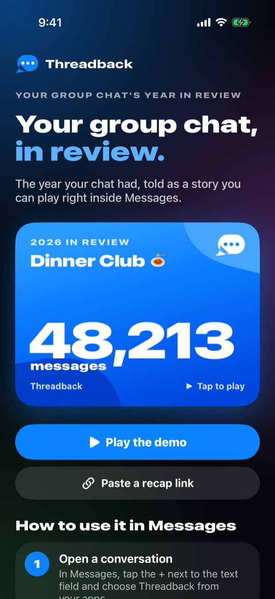

### app-02-home-how-to

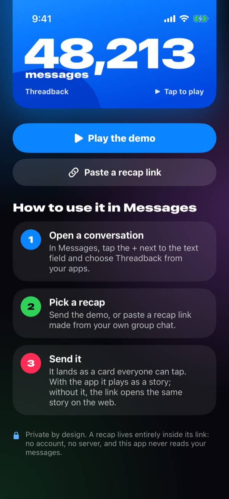

### app-03-story-slide-1

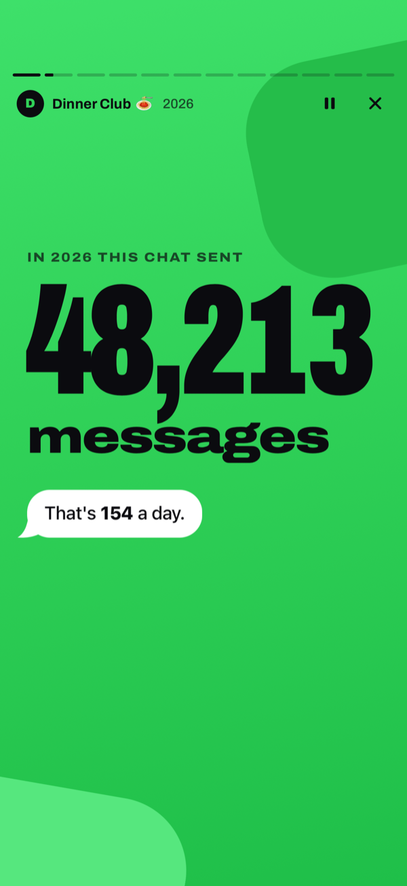

### app-04-story-slide-2

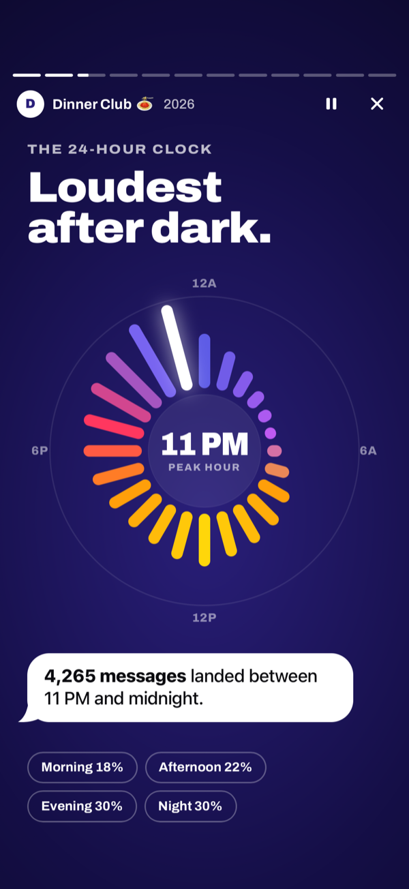

### app-05-story-slide-3

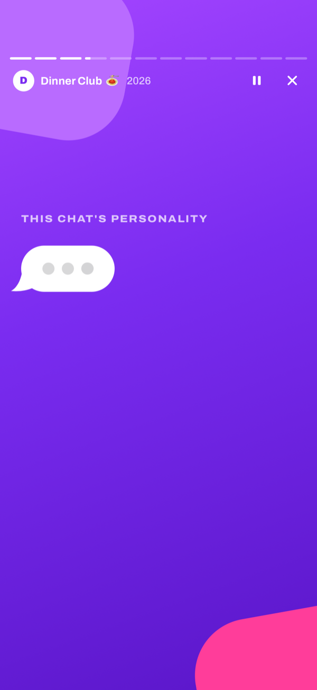

### app-06-story-slide-4

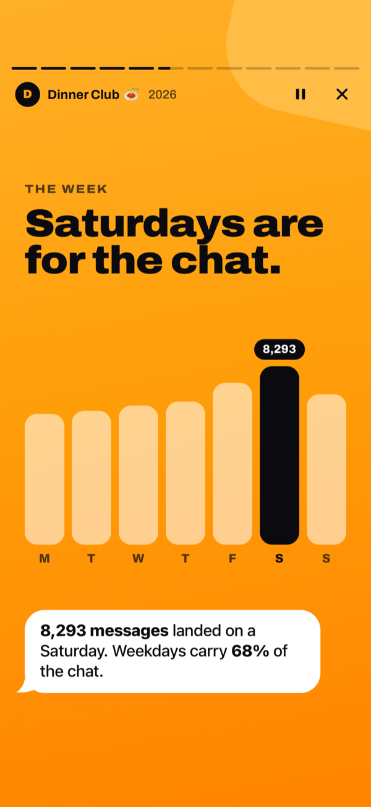

### app-07-story-slide-5

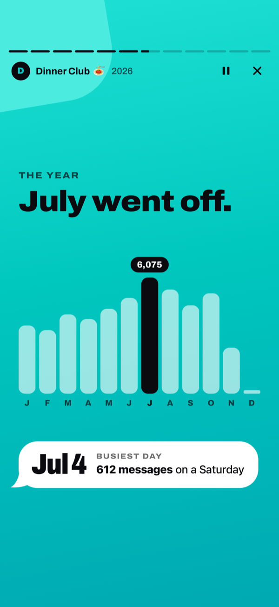

### app-08-story-opened-from-link

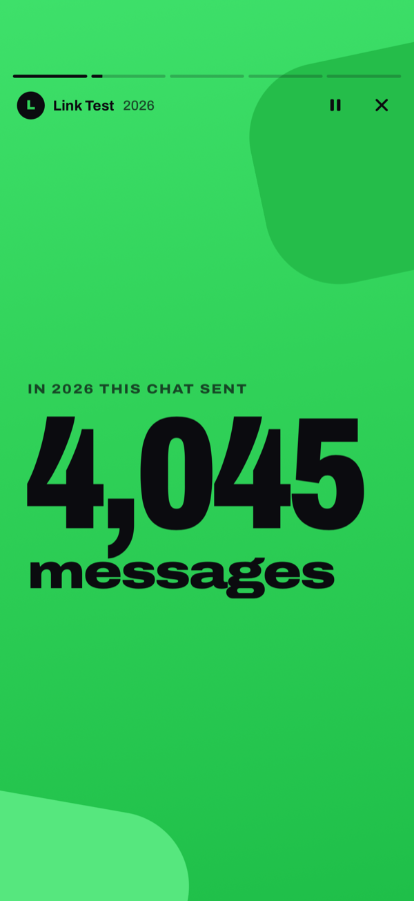

### gallery-01-card-and-bubble-NOT-MESSAGES

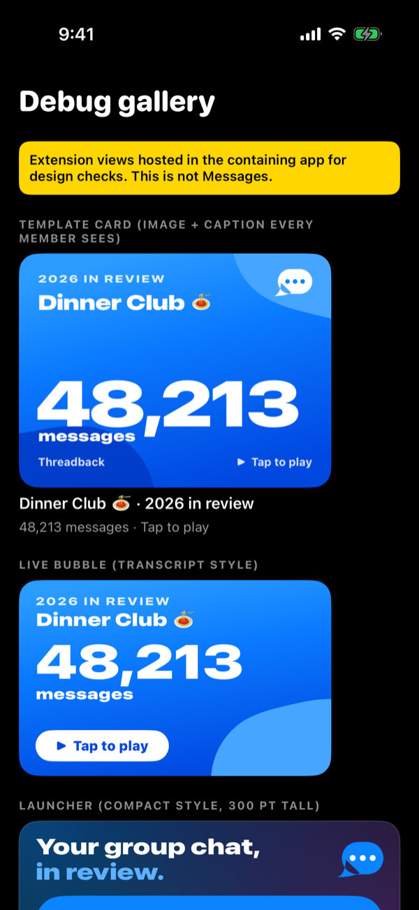

### gallery-02-launcher-NOT-MESSAGES

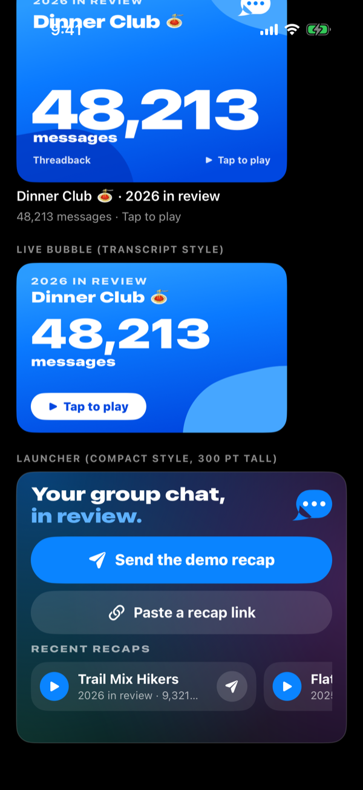

### messages-01-launched

### messages-02-conversation-list

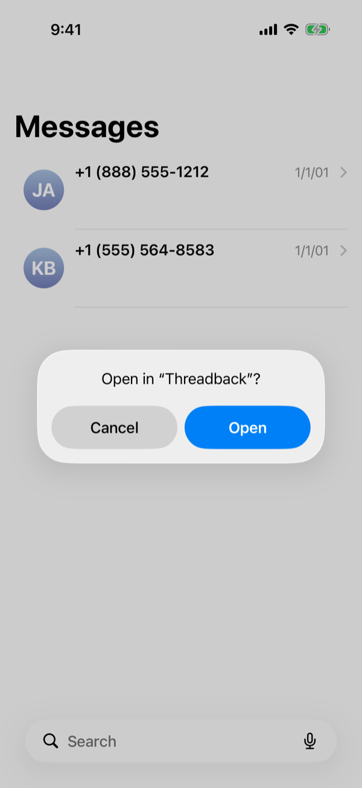

### messages-03-conversation

### messages-04-app-drawer

### messages-05-more

### messages-05b-after-swipe

### messages-06-extension-compact

### messages-07-bubble-staged

### messages-08-bubble-sent

### messages-09-story-expanded

### render-live-bubble-demo

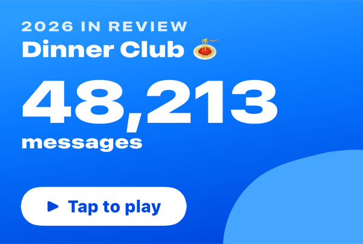

### render-share-card-demo

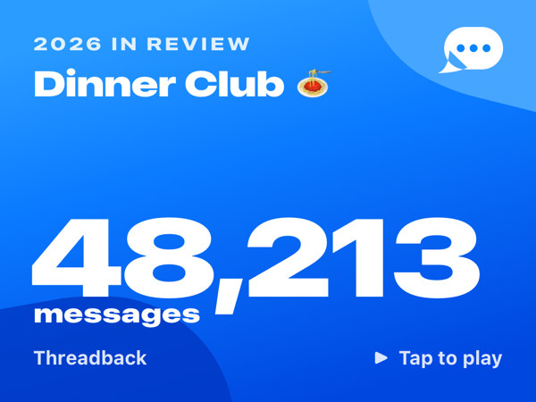

### render-share-card-long-name

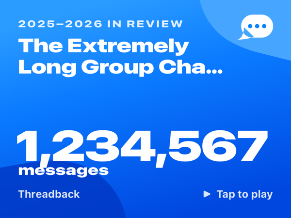

### simctl-01-home

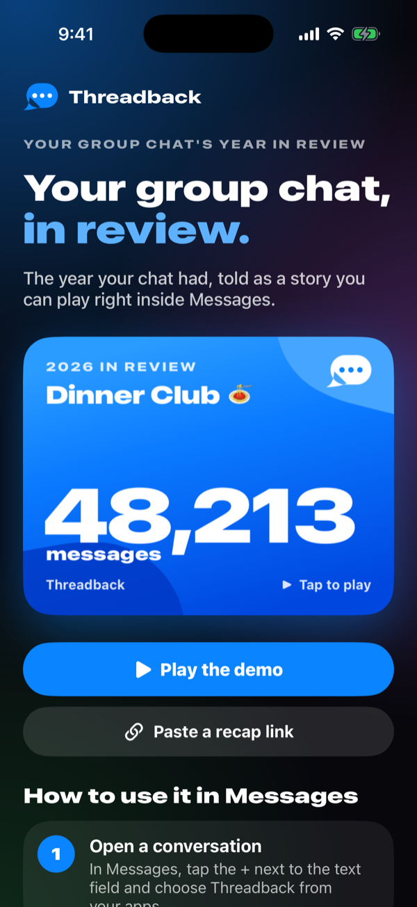

### simctl-02-demo-story

### simctl-03-demo-story-later

### simctl-04-opened-by-url-scheme

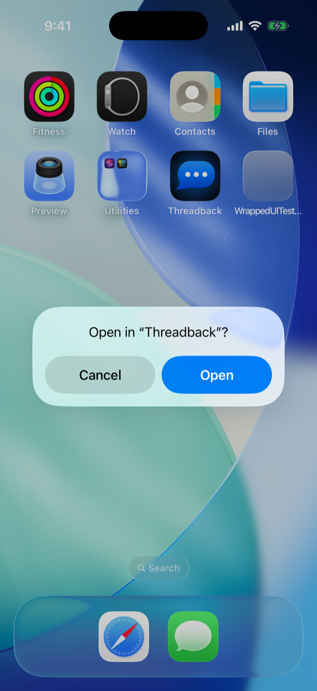

