# iOS Simulator screenshots

Generated by the `iOS` workflow; do not edit by hand. Every run replaces this folder.

- Run: https://github.com/averyhsu/imessage-wrap/actions/runs/43047037123
- Simulator: iPhone 17 Pro (iOS 26.5)
- Story shown in the app: the **real** web story
- Test results and notes of that run: [TEST-RESULTS.txt](TEST-RESULTS.txt)
- Screen recordings: every run uploads full-size ones as the `ios-video` artifact; a
  compressed `app-demo-story.mp4` is committed here only when a run is asked to.

What the file names mean:

| Prefix | What it is |
|--------|------------|
| `app-` | The containing app on the Simulator, captured by UI tests. |
| `simctl-` | The containing app, launched and captured with `xcrun simctl`. |
| `gallery-` | The extension's native views hosted in the app's debug gallery. **Not Messages.** |
| `render-` | Offscreen renders from unit tests (share card, live bubble). **Not Messages.** |
| `messages-` | The real Messages app in the Simulator (automation attempt; see the test results for how far it got). |

### app-01-home

### app-02-home-how-to

### app-03-story-slide-1

### app-04-story-slide-2

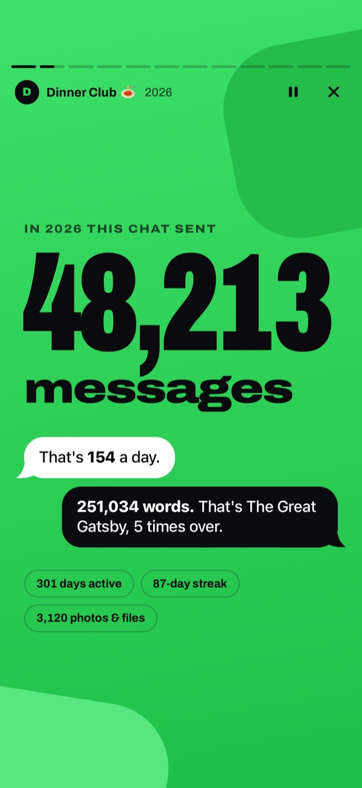

### app-05-story-slide-3

### app-06-story-slide-4

### app-07-story-slide-5

### app-08-story-opened-from-link

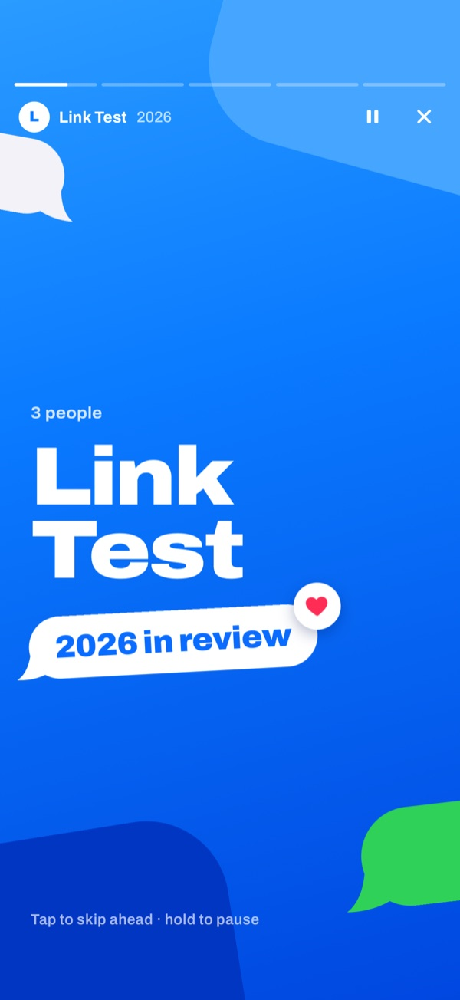

### app-09-story-opened-by-url-scheme

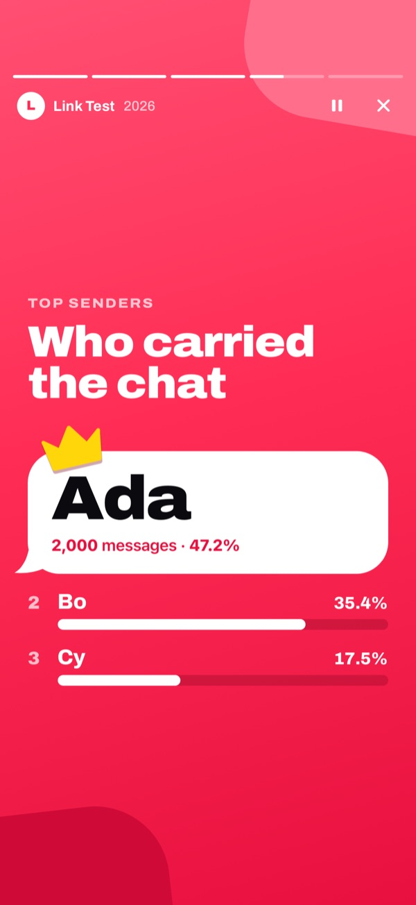

### gallery-01-card-and-bubble-NOT-MESSAGES

### gallery-02-launcher-NOT-MESSAGES

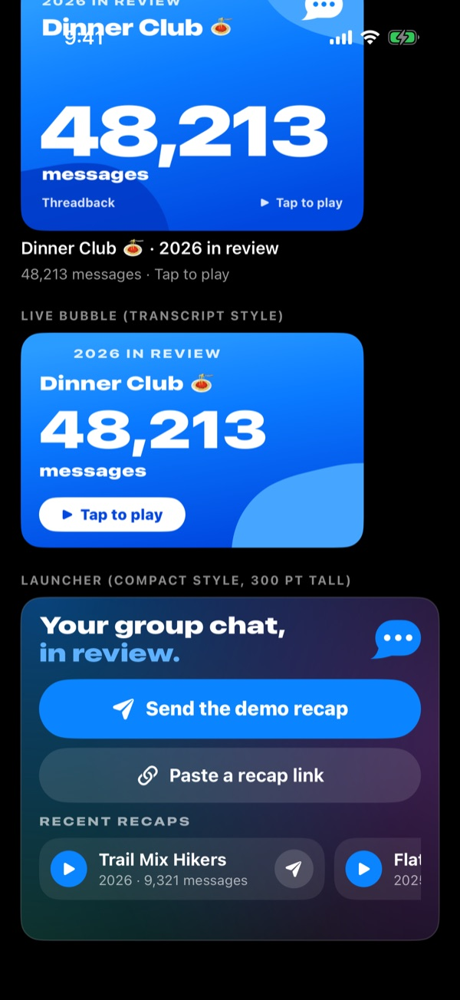

### messages-01-conversation-list

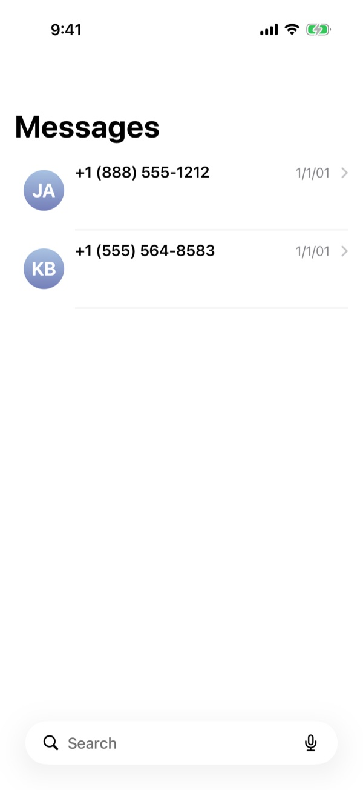

### messages-02-conversation

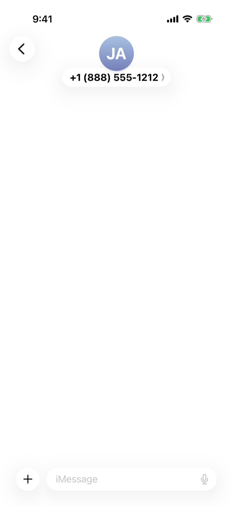

### messages-03-app-drawer

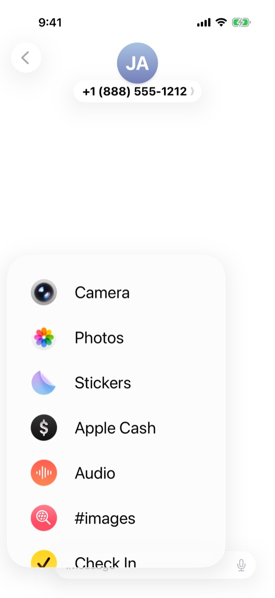

### messages-04-app-drawer-our-app

### messages-05-launcher-compact

### messages-06-bubble-staged

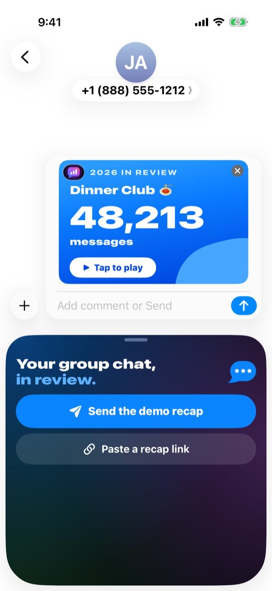

### messages-07-bubble-sent

### messages-08-story-expanded

### messages-09-story-next-slide

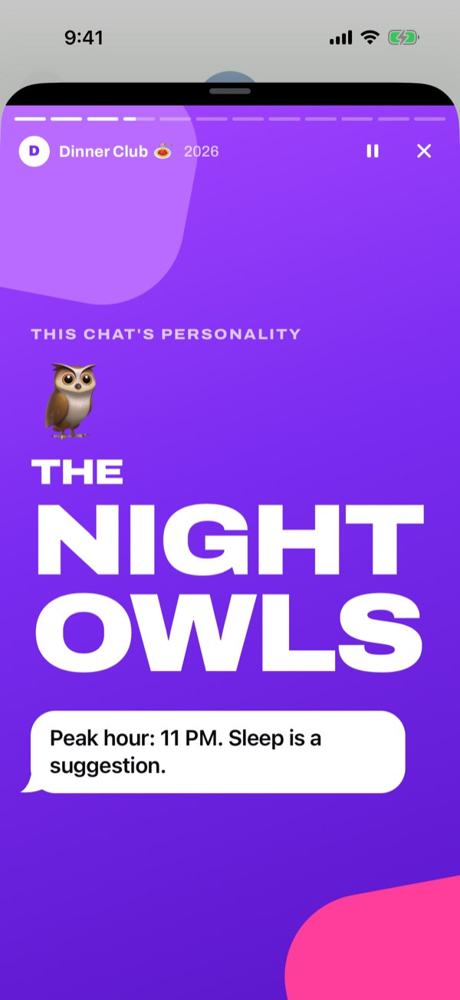

### messages-10-story-another-slide

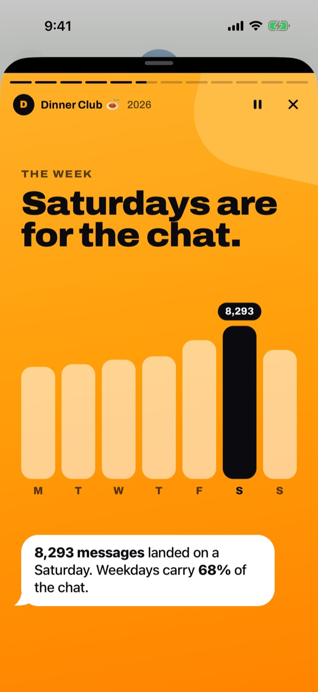

### messages-11-after-close

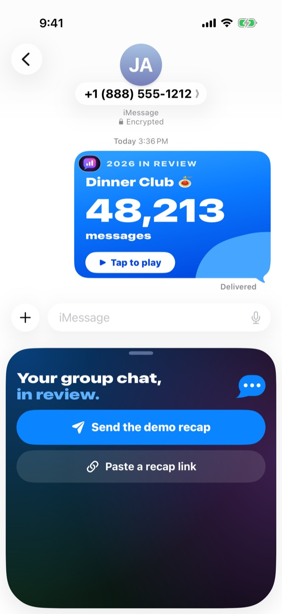

### render-live-bubble-demo

### render-share-card-demo

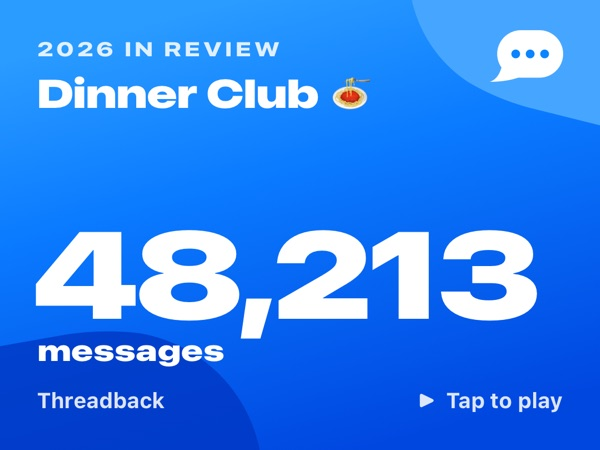

### render-share-card-long-name

### simctl-01-home

### simctl-02-demo-story

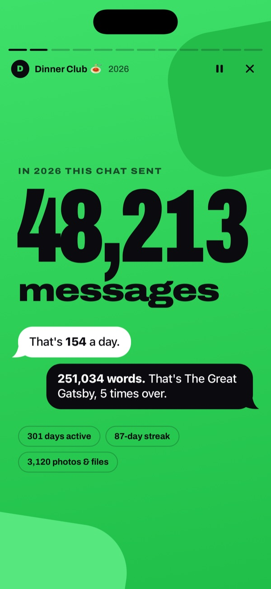

### simctl-03-demo-story-later

