# iOS Simulator screenshots

Generated by the `iOS` workflow; do not edit by hand. Every run replaces this folder.

- Run: https://github.com/averyhsu/imessage-wrap/actions/runs/43085945658
- Simulator: iPhone 17 Pro (iOS 26.5)
- Story shown in the app: the **real** web story
- Test results and notes of that run: [TEST-RESULTS.txt](TEST-RESULTS.txt)
- Screen recordings: every run uploads full-size ones as the `ios-video` artifact.
  Compressed copies (`app-demo-story.mp4`, the sample story in the app, and
  `messages-card-flow-3x.mp4`, the walkthrough inside Messages at 3x speed) are
  committed here only when a run is asked to, so they can be older than the images.

What the file names mean:

| Prefix | What it is |
|--------|------------|
| `messages-` | The real Messages app in the Simulator, in order: paste a recap link, send the card, tap it, the story plays, close, play the sample, clear. This is the product. |
| `app-` | The containing app on the Simulator, captured by UI tests. |
| `simctl-` | The containing app, launched and captured with `xcrun simctl`. |
| `gallery-` | The extension's native views hosted in the app's debug gallery. **Not Messages.** |
| `render-` | The share card, drawn offscreen by unit tests. **Not Messages.** |
| `experimental-` | The live bubble layout: experimental, **off by default, not part of the product**. Listed last, under its own heading. |

All chats, names, numbers and messages shown are invented.

### messages-01-conversation-list

### messages-02-app-drawer

### messages-03-launcher

### messages-04-ios-asks-before-pasting

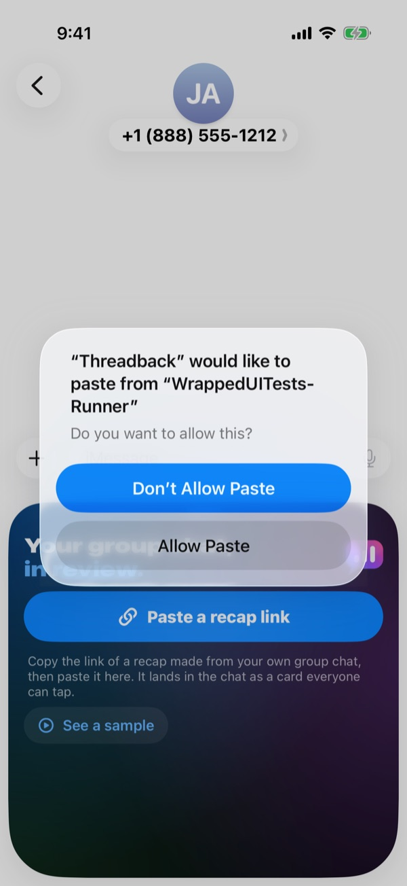

### messages-05-card-staged

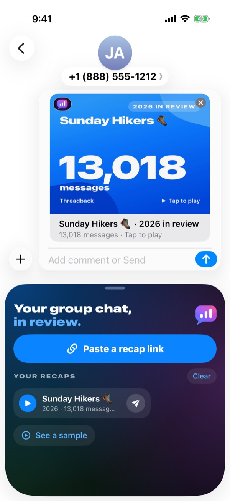

### messages-06-card-sent

### messages-07-story-plays

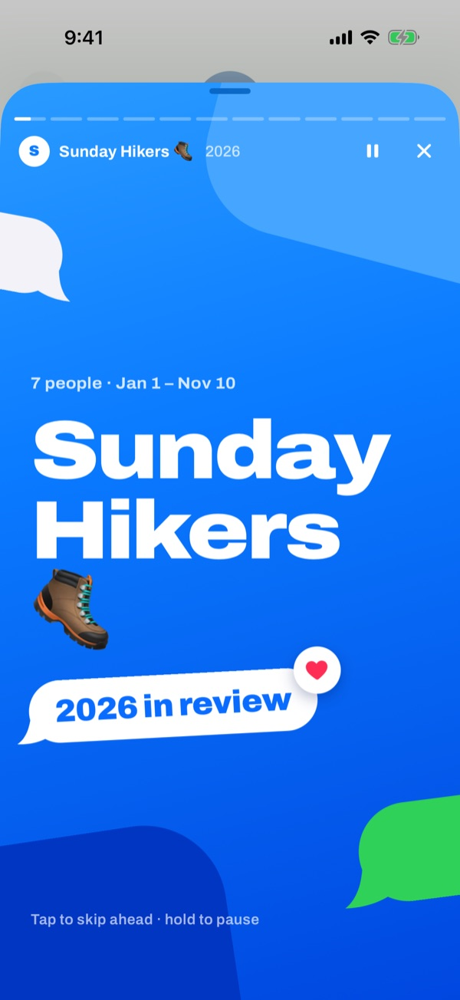

### messages-08-story-next-slide

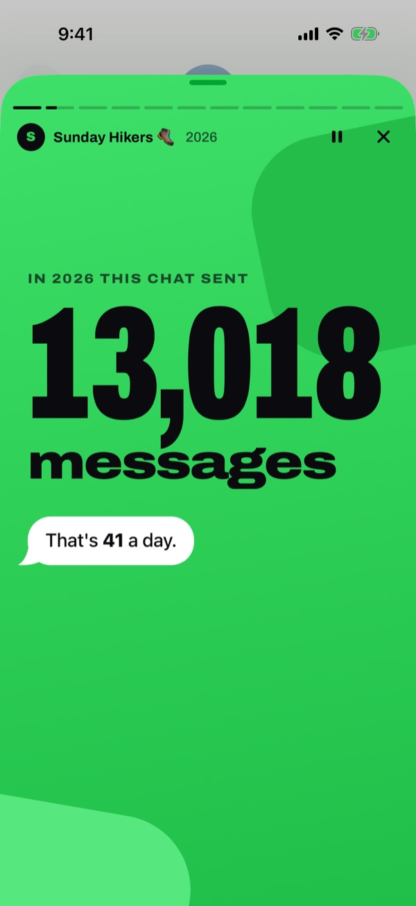

### messages-09-story-another-slide

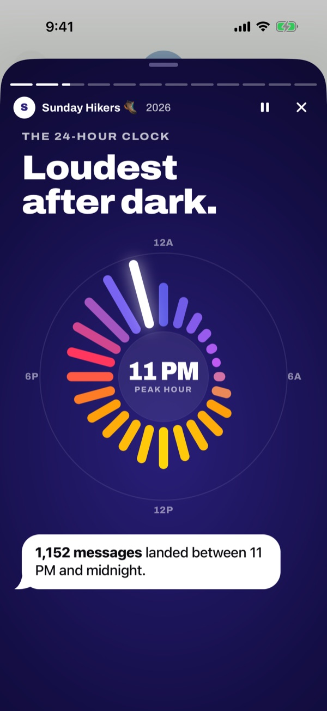

### messages-10-closed-recap-is-kept

### messages-11-sample-plays

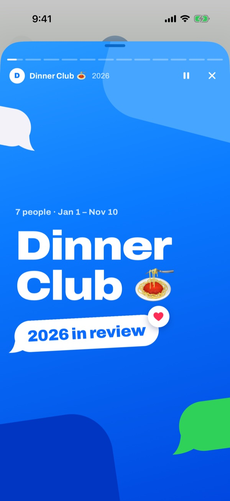

### messages-12-your-recaps-cleared

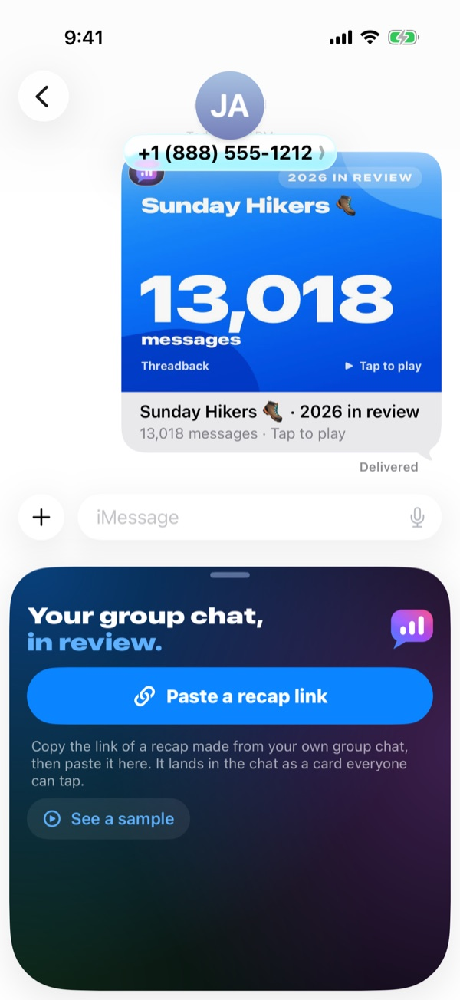

### app-01-home

### app-02-home-how-to

### app-03-story-slide-1

### app-04-story-slide-2

### app-05-story-slide-3

### app-06-story-slide-4

### app-07-story-slide-5

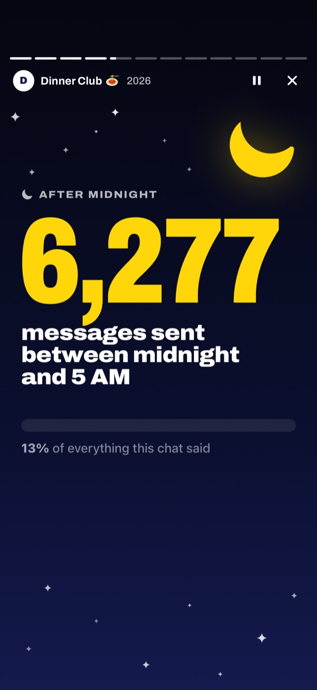

### app-08-story-opened-from-link

### app-09-story-opened-by-url-scheme

### app-10-just-after-tapping-play

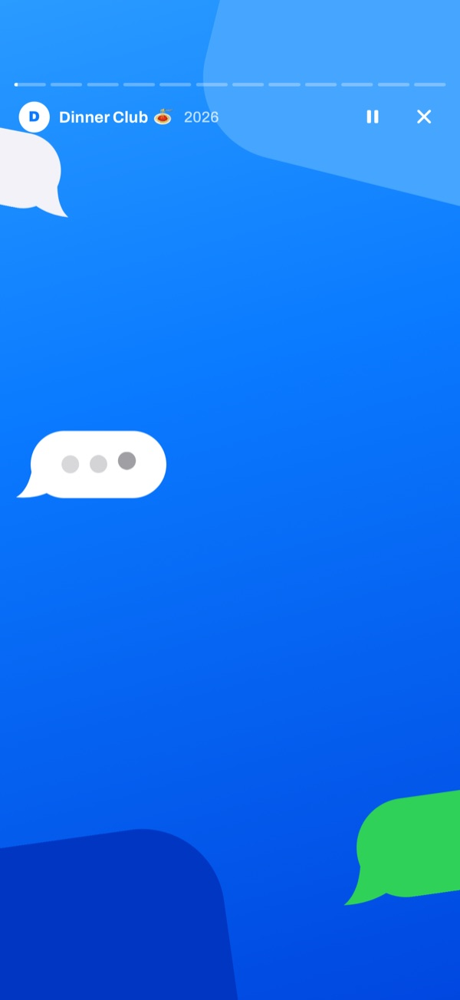

### app-11-home-your-recaps

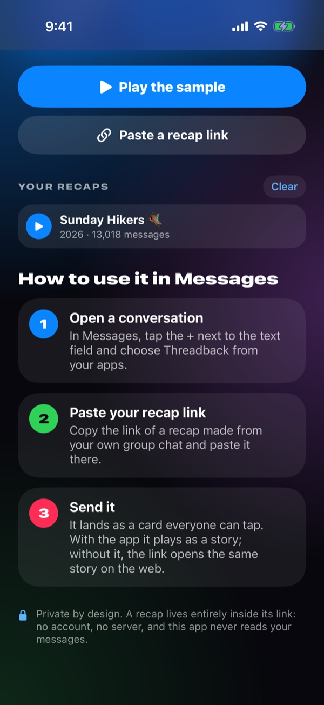

### simctl-01-home

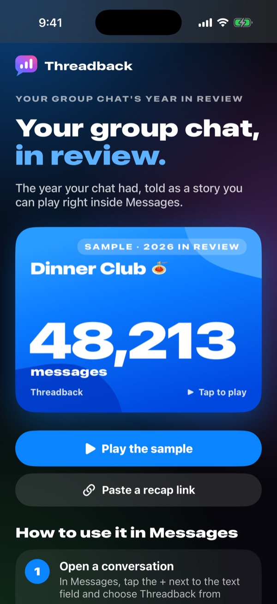

### simctl-02-demo-story

### simctl-03-demo-story-later

### gallery-01-card-and-launcher-NOT-MESSAGES

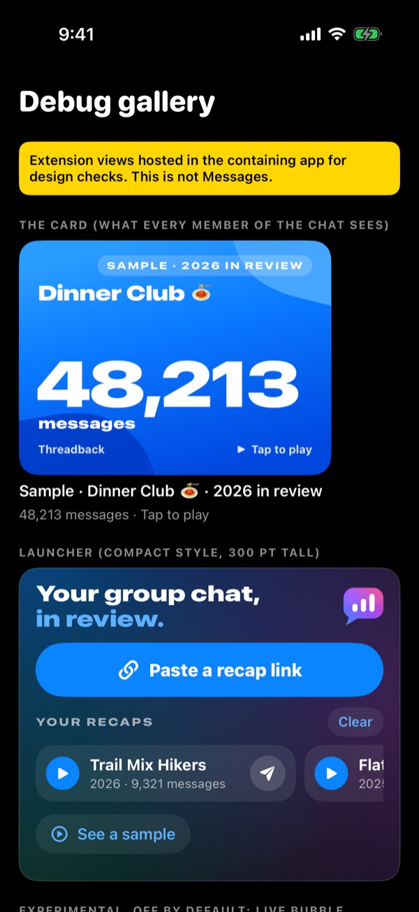

### render-share-card-long-name

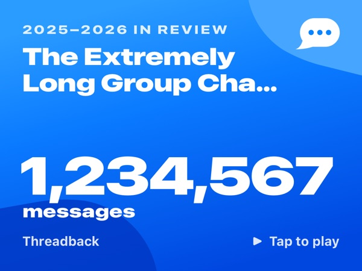

### render-share-card-sample

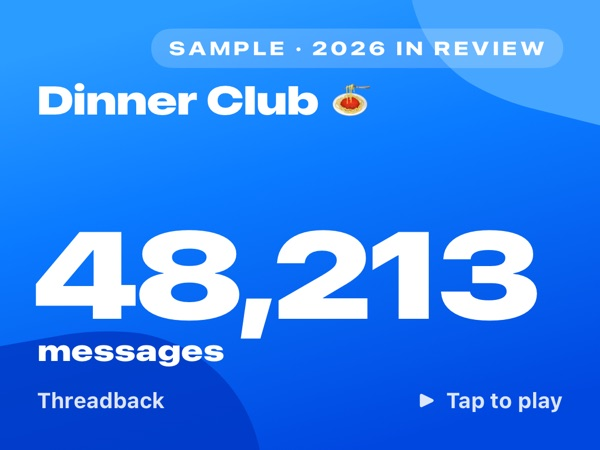

### render-share-card

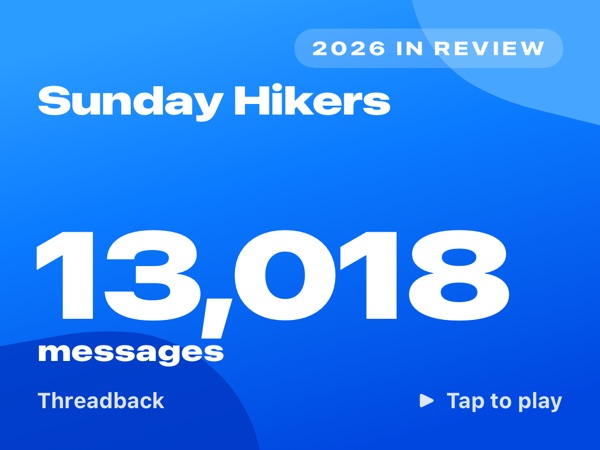

## Experimental: the live bubble layout (off by default, not part of the product)

The app sends a card (above). A live, native bubble is an experiment kept behind a
switch that is off: in the Simulator a received live bubble is handed no message by
Messages, so it cannot show the recap. These captures only track that experiment.

### experimental-live-01-conversation-list

### experimental-live-02-app-drawer

### experimental-live-03-launcher

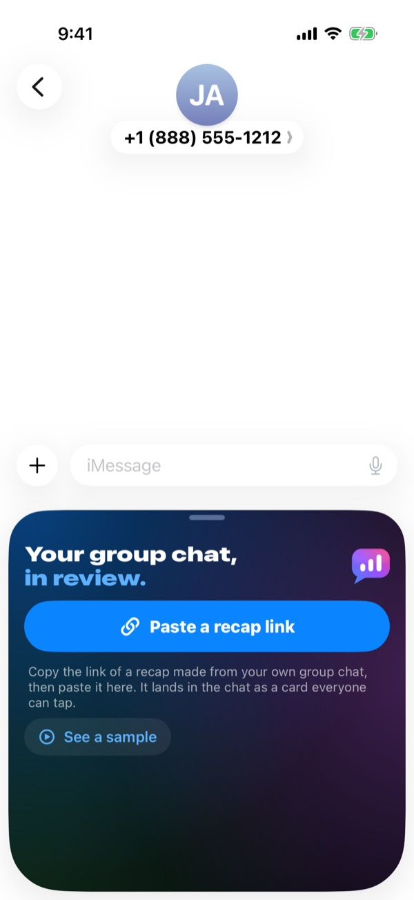

### experimental-live-04-bubble-staged

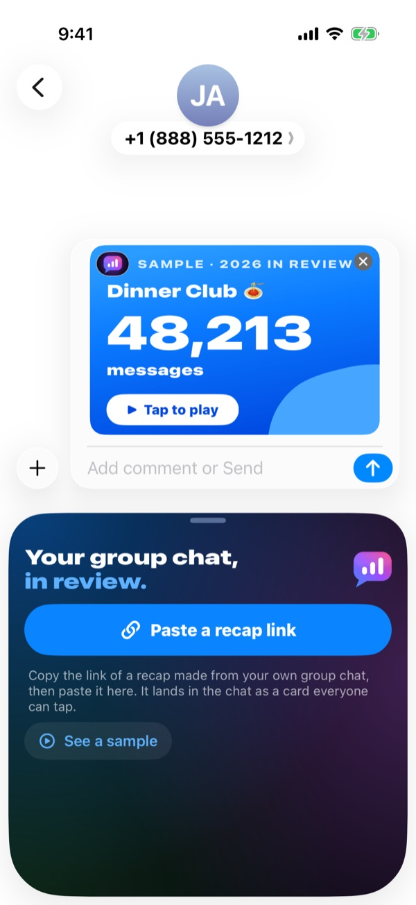

### experimental-live-05-bubble-sent

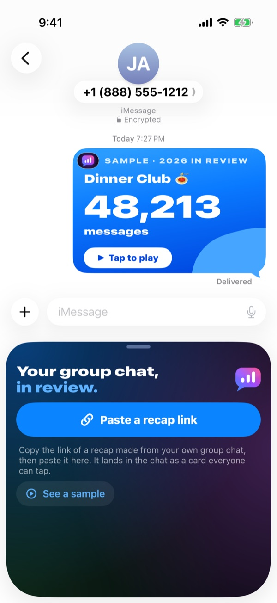

### experimental-live-06-story-plays

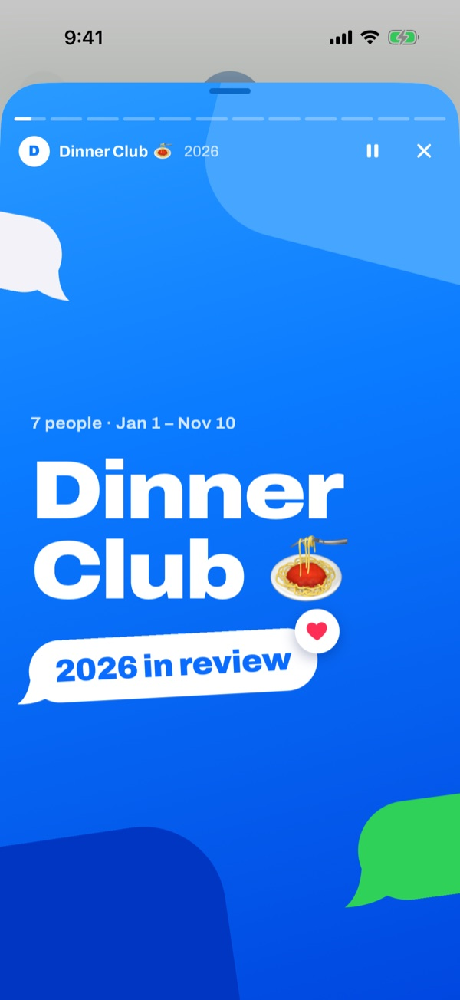

### experimental-live-07-story-next-slide

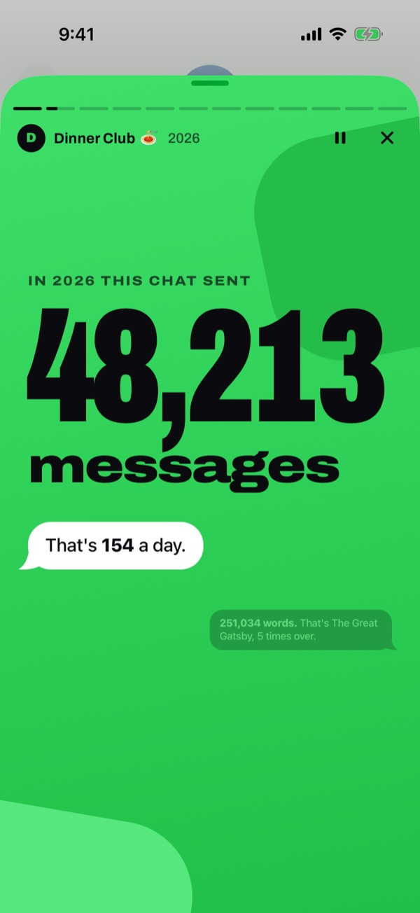

### experimental-live-08-story-another-slide

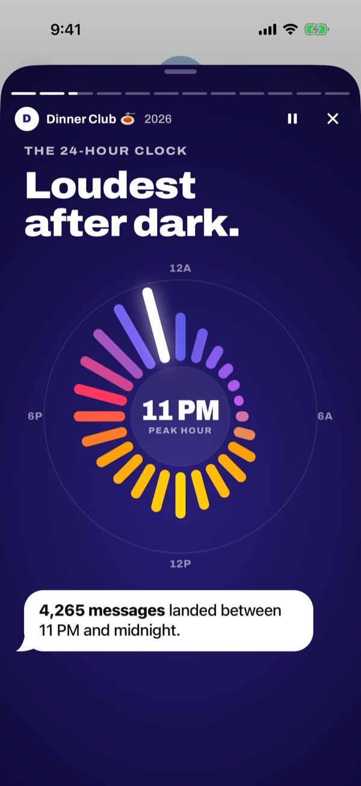

### experimental-live-09-after-close

### experimental-live-10-other-end-of-the-chat

### experimental-live-11-received-bubble

### experimental-live-12-received-bubble-plays

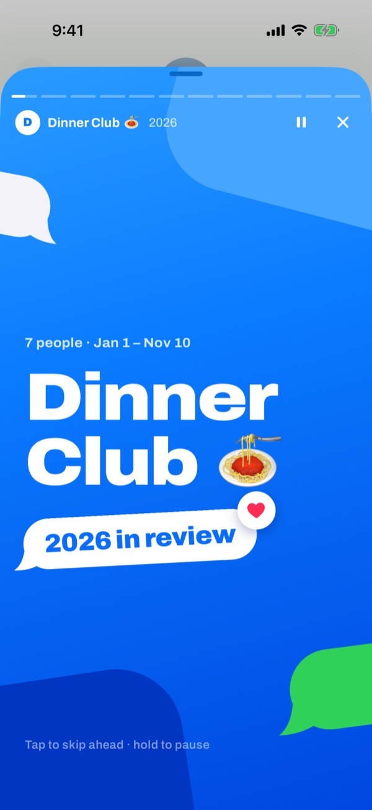

### experimental-render-live-bubble

