# iOS Simulator screenshots

Generated by the `iOS` workflow; do not edit by hand. Every run replaces this folder.

- Run: https://github.com/averyhsu/imessage-wrap/actions/runs/43058727671
- Simulator: iPhone 17 Pro (iOS 26.5)
- Story shown in the app: the **real** web story
- Test results and notes of that run: [TEST-RESULTS.txt](TEST-RESULTS.txt)
- Screen recordings: every run uploads full-size ones as the `ios-video` artifact.
  Compressed copies (`app-demo-story.mp4`, the demo story in the app, and
  `messages-extension-3x.mp4`, the walkthrough inside Messages at 3x speed) are
  committed here only when a run is asked to, so they can be older than the images.

What the file names mean:

| Prefix | What it is |
|--------|------------|
| `app-` | The containing app on the Simulator, captured by UI tests. |
| `simctl-` | The containing app, launched and captured with `xcrun simctl`. |
| `gallery-` | The extension's native views hosted in the app's debug gallery. **Not Messages.** |
| `render-` | Offscreen renders from unit tests (share card, live bubble). **Not Messages.** |
| `messages-` | The real Messages app in the Simulator (automation attempt; see the test results for how far it got). |

### app-01-home

### app-02-home-how-to

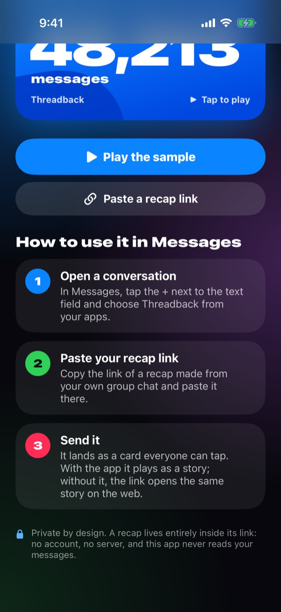

### app-03-story-slide-1

### app-04-story-slide-2

### app-05-story-slide-3

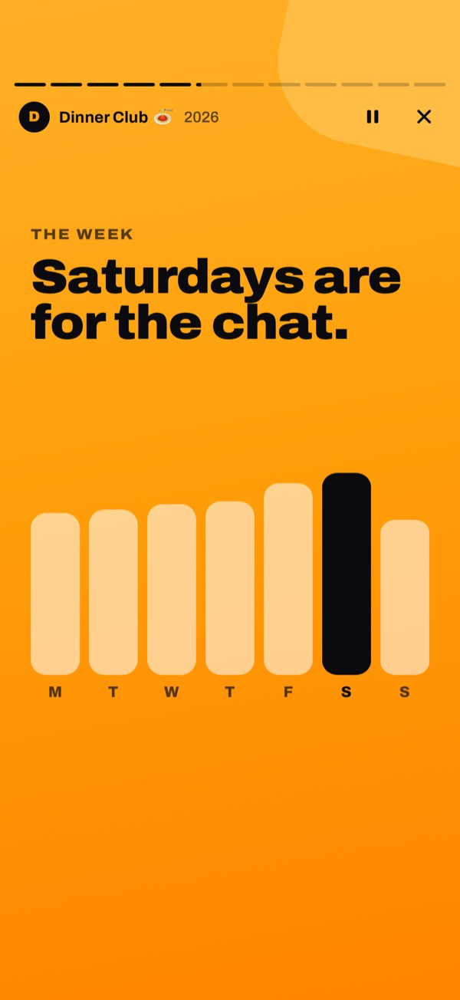

### app-06-story-slide-4

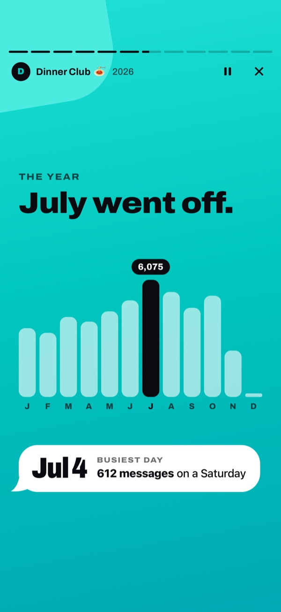

### app-07-story-slide-5

### app-08-story-opened-from-link

### app-09-story-opened-by-url-scheme

### gallery-01-card-and-bubble-NOT-MESSAGES

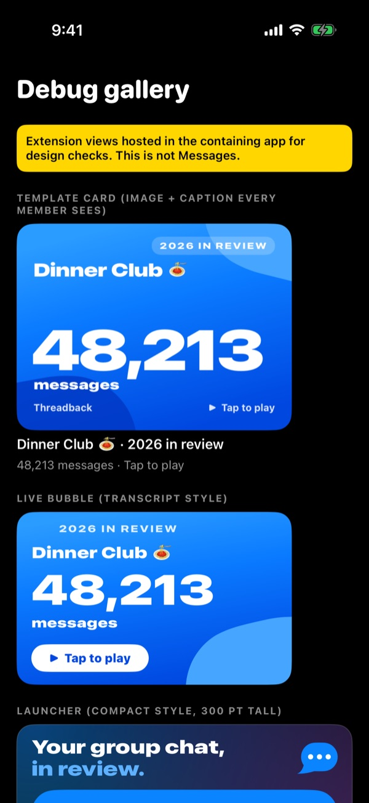

### gallery-02-launcher-NOT-MESSAGES

### messages-live-1-conversation-list

### messages-live-2-app-drawer

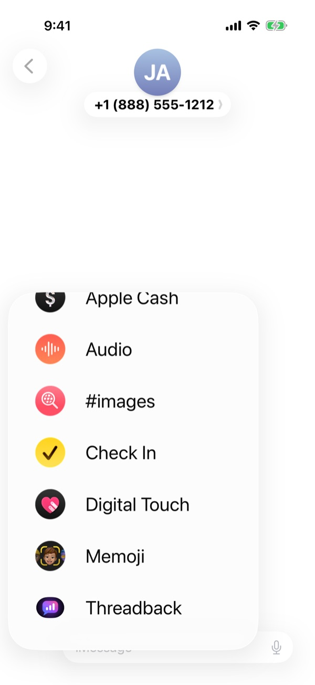

### messages-live-3-launcher-compact

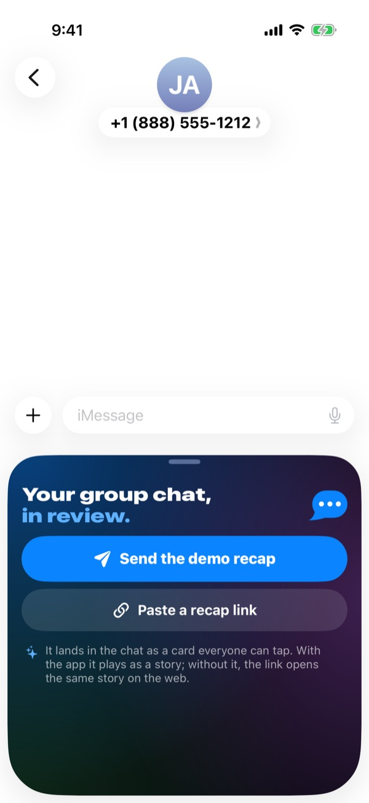

### messages-live-4-bubble-staged

### messages-live-5-bubble-sent

### messages-live-6-story-expanded

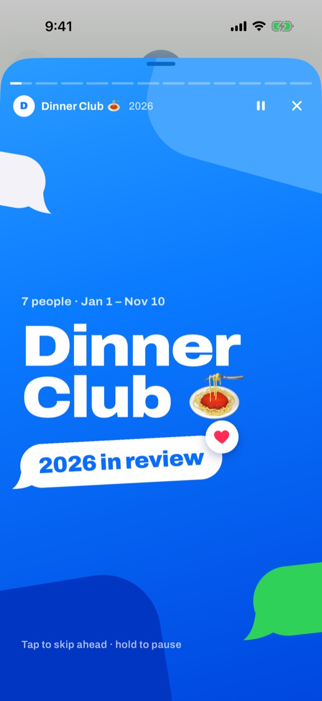

### messages-live-7-story-next-slide

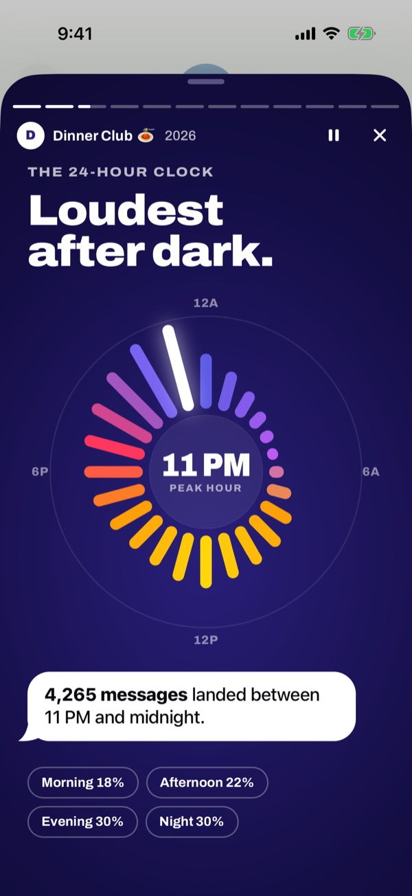

### messages-live-8-story-another-slide

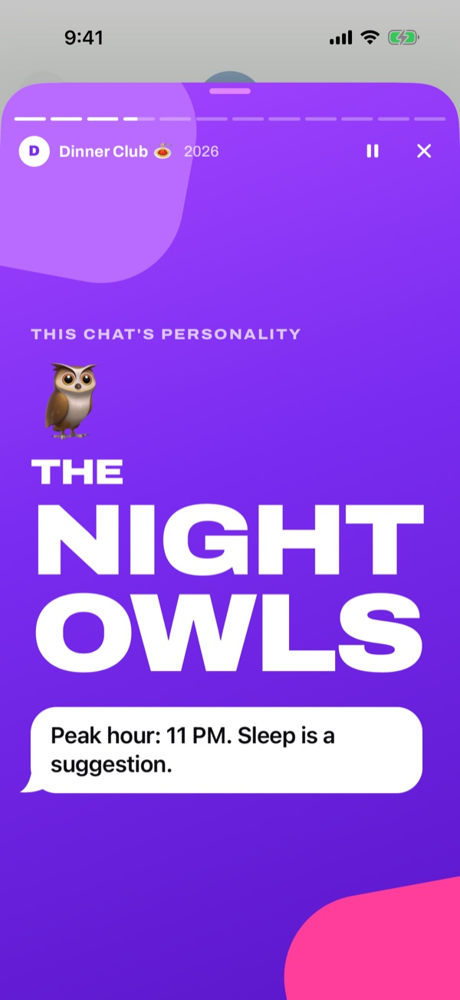

### messages-live-9-after-close

### messages-live-91-other-end-of-the-chat

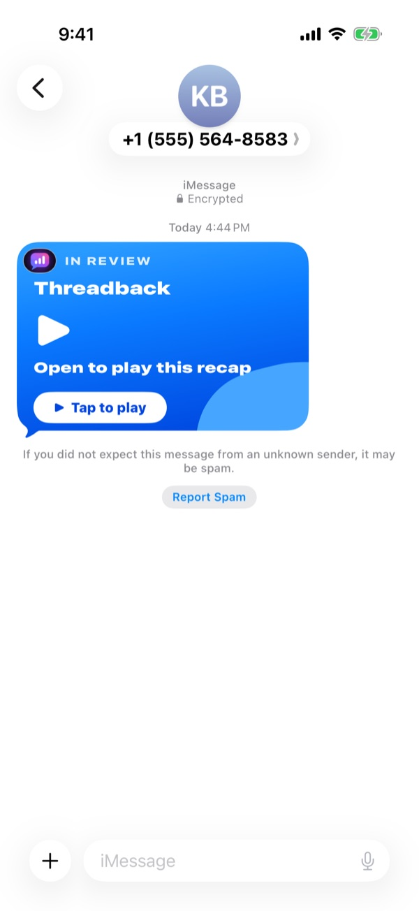

### messages-live-92-received-bubble

### messages-live-93-received-bubble-plays

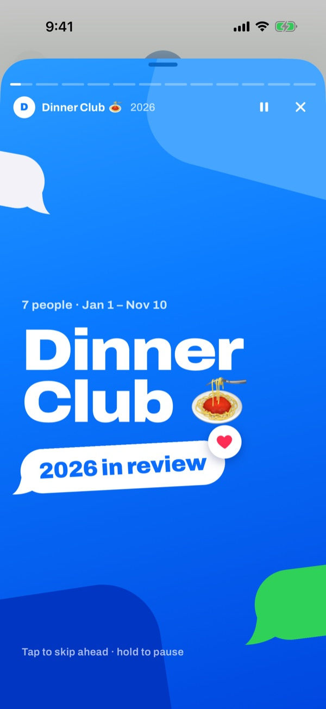

### messages-template-1-conversation-list

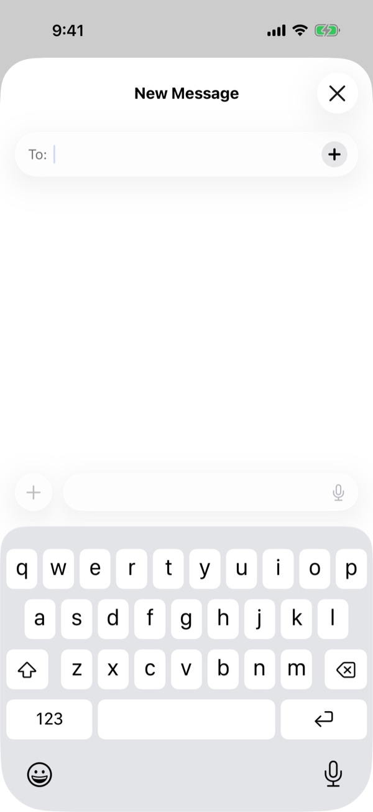

### messages-template-2-app-drawer

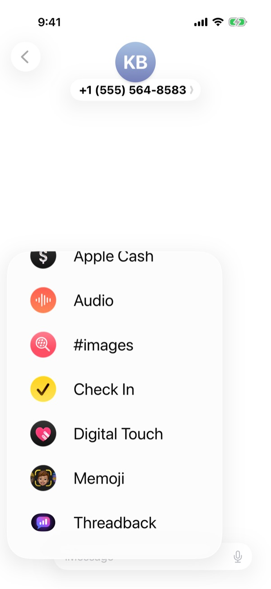

### messages-template-3-launcher-compact

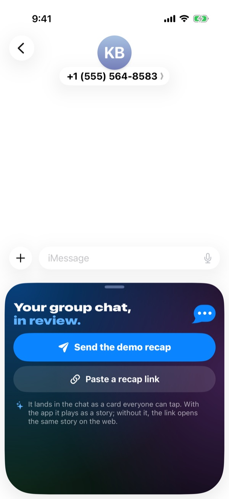

### messages-template-4-bubble-staged

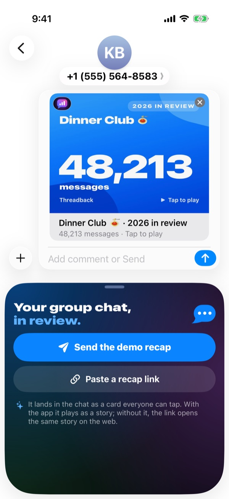

### messages-template-5-card-sent

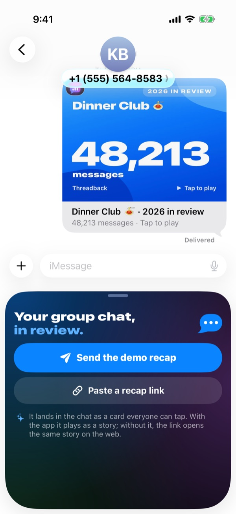

### messages-template-6-story-expanded

### messages-template-7-story-next-slide

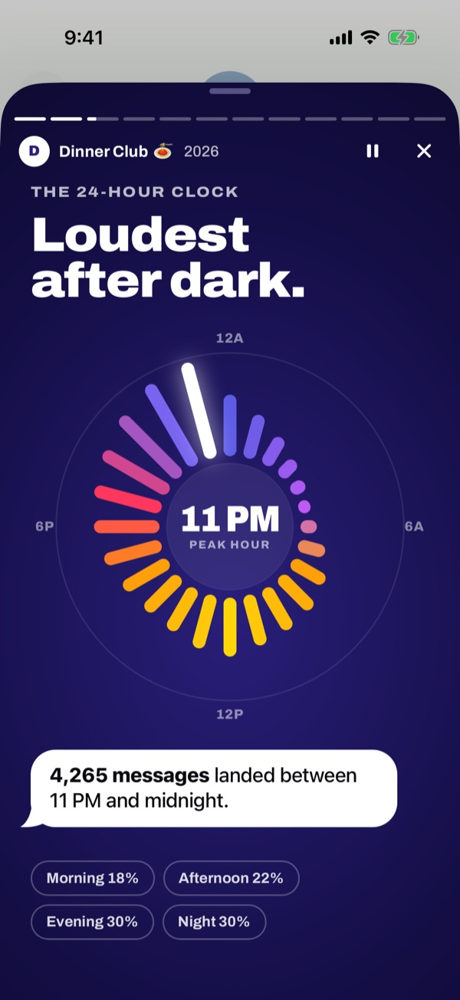

### messages-template-8-story-another-slide

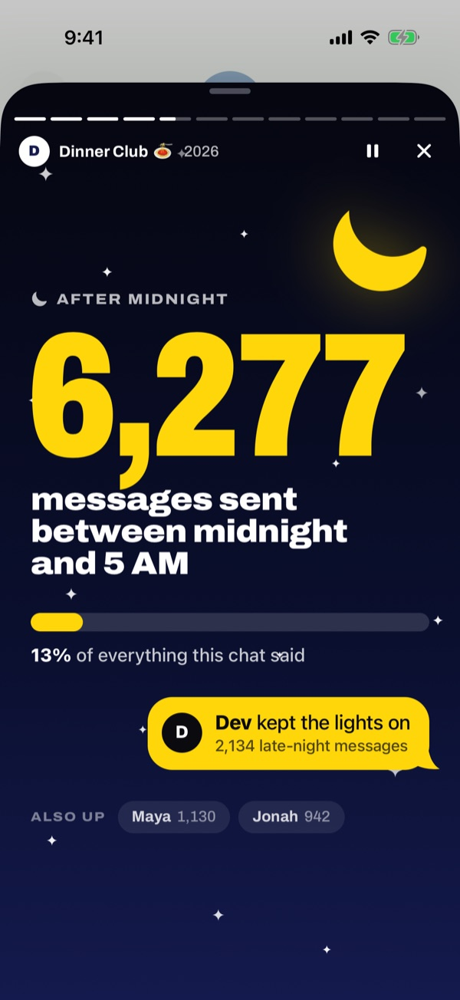

### messages-template-9-after-close

### render-live-bubble-demo

### render-share-card-demo

### render-share-card-long-name

### simctl-01-home

### simctl-02-demo-story

### simctl-03-demo-story-later

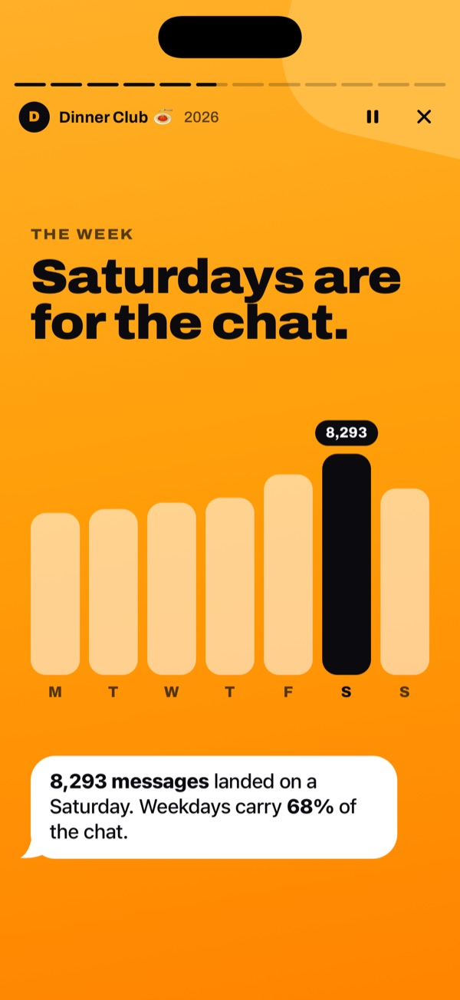

