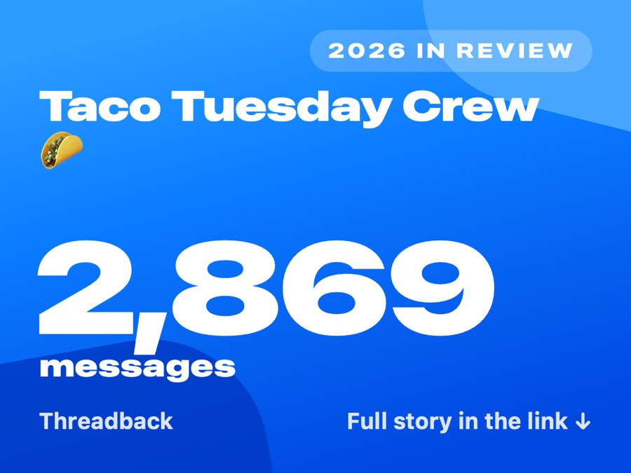

# Threadback for Mac: spike screenshots

Generated by the `Mac app` workflow (`.github/workflows/mac-app.yml`); do not edit by hand.
Every run replaces this folder. All chats, names and numbers are invented.

- Run: https://github.com/averyhsu/imessage-wrap/actions/runs/43149163353
- Everything the run measured, as text: [MAC-APP-RESULTS.txt](MAC-APP-RESULTS.txt)

| File | What it shows |
|------|---------------|
| [`access-1-open-panel-preset`](access-1-open-panel-preset.jpg) | Proof 6b, real ~/Library/Messages on the runner: the Open panel as the app opens it (preset folder, "Grant Access"). |
| [`access-2-go-to-folder`](access-2-go-to-folder.jpg) | Proof 6b: Command-Shift-G (Go to Folder) inside the panel. |
| [`access-3-in-messages-folder`](access-3-in-messages-folder.jpg) | Proof 6b: the panel inside ~/Library/Messages, before Grant Access. |
| [`access-4-after-grant`](access-4-after-grant.jpg) | Proof 6b: the app's window after Grant Access: connected, or the error it got. |
| [`access-5-contacts-prompt`](access-5-contacts-prompt.jpg) | The Contacts prompt (optional names), if it appeared (whole screen). |
| [`card-taco-2026`](card-taco-2026.jpg) | The reply's image for the invented "Taco Tuesday Crew" chat, 2026, rendered by the app in a dry run (proof 3). |
| [`system-1-messages-first-launch`](system-1-messages-first-launch.jpg) | The runner's Messages app on first launch (not signed in), captured with screencapture. |

### card-taco-2026

The reply's image for the invented "Taco Tuesday Crew" chat, 2026, rendered by the app in a dry run (proof 3).

### access-1-open-panel-preset

Proof 6b, real ~/Library/Messages on the runner: the Open panel as the app opens it (preset folder, "Grant Access").

### access-2-go-to-folder

Proof 6b: Command-Shift-G (Go to Folder) inside the panel.

### access-3-in-messages-folder

Proof 6b: the panel inside ~/Library/Messages, before Grant Access.

### access-4-after-grant

Proof 6b: the app's window after Grant Access: connected, or the error it got.

### access-5-contacts-prompt

The Contacts prompt (optional names), if it appeared (whole screen).

### system-1-messages-first-launch

The runner's Messages app on first launch (not signed in), captured with screencapture.

