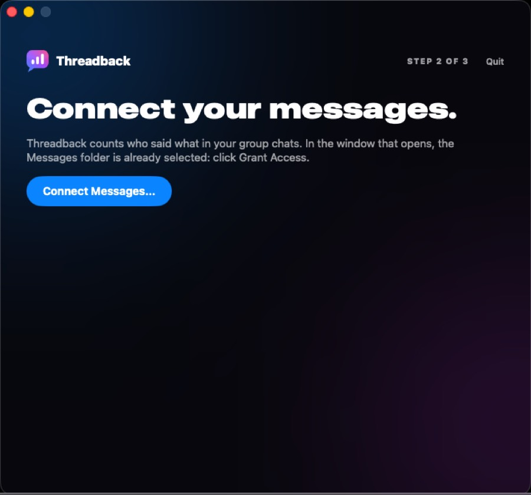
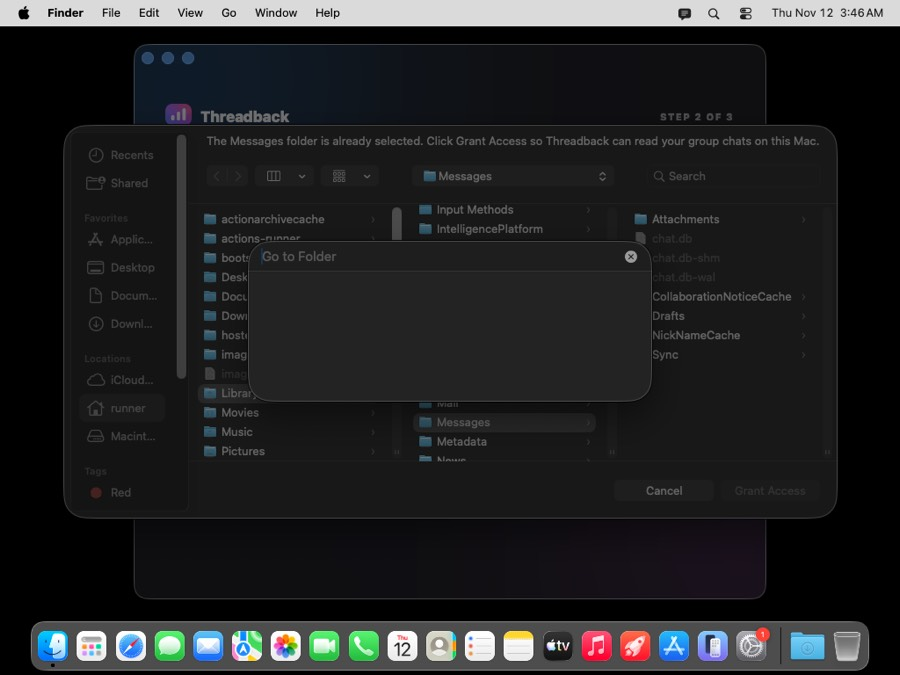
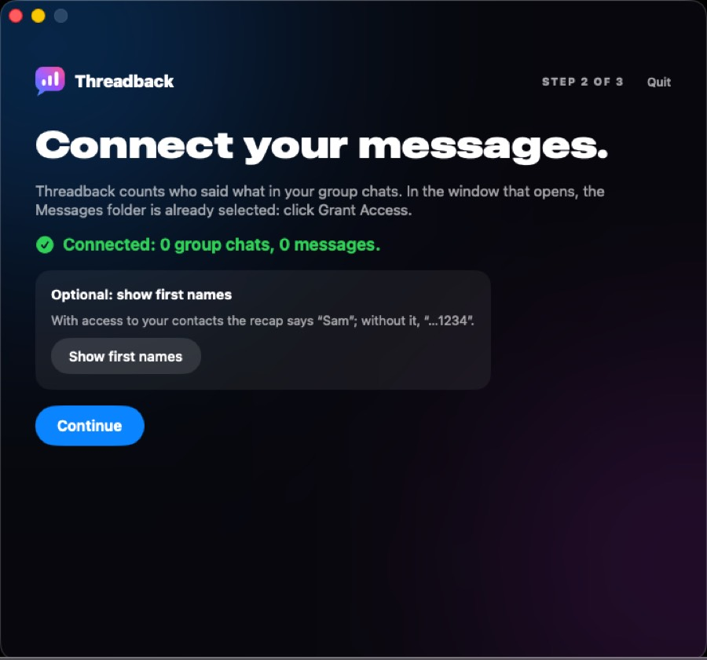
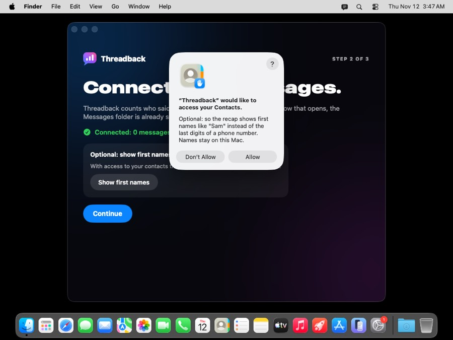
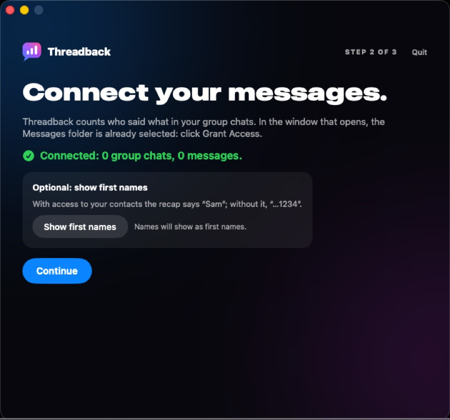
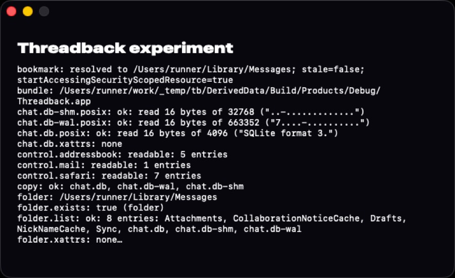
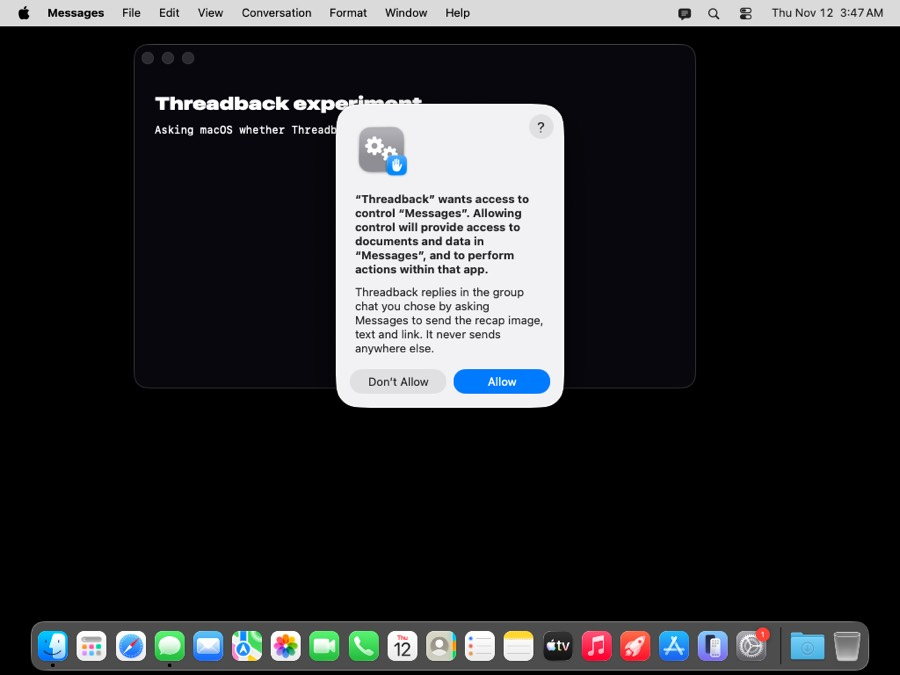
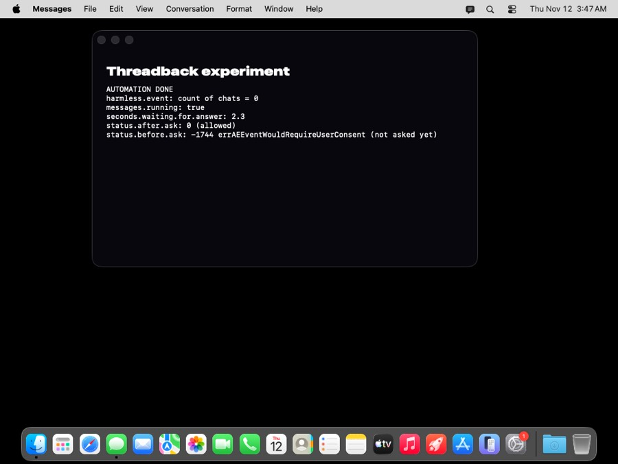

# Threadback for Mac: spike screenshots

Generated by the `Mac app` workflow (`.github/workflows/mac-app.yml`); do not edit by hand.
Every run replaces this folder. All chats, names and numbers are invented.

- Run: https://github.com/averyhsu/imessage-wrap/actions/runs/43150243648
- Everything the run measured, as text: [MAC-APP-RESULTS.txt](MAC-APP-RESULTS.txt)

| File | What it shows |
|------|---------------|
| [`access-1-open-panel-preset`](access-1-open-panel-preset.jpg) | Proof 6b, real ~/Library/Messages on the runner: the Open panel as the app opens it (preset folder, "Grant Access"). |
| [`access-2-go-to-folder`](access-2-go-to-folder.jpg) | Proof 6b: Command-Shift-G (Go to Folder) inside the panel. |
| [`access-3-in-messages-folder`](access-3-in-messages-folder.jpg) | Proof 6b: the panel inside ~/Library/Messages, before Grant Access. |
| [`access-4-after-grant`](access-4-after-grant.jpg) | Proof 6b: the app's window after Grant Access: connected, or the error it got. |
| [`access-5-contacts-prompt`](access-5-contacts-prompt.jpg) | The Contacts prompt (optional names), if it appeared (whole screen). |
| [`access-6-after-contacts`](access-6-after-contacts.jpg) | The app after the Contacts prompt was answered (or not). |
| [`access-7-relaunch-bookmark`](access-7-relaunch-bookmark.jpg) | Proof 6b: a new launch reading through the stored bookmark (the report window). |
| [`automation-1-screen`](automation-1-screen.jpg) | Proof 7: the screen while the app asks macOS for permission to control Messages. |
| [`automation-2-screen`](automation-2-screen.jpg) | Proof 7: the screen while the app asks macOS for permission to control Messages. |
| [`automation-4-result`](automation-4-result.jpg) | Proof 7: the screen while the app asks macOS for permission to control Messages. |
| [`card-taco-2026`](card-taco-2026.jpg) | The reply's image for the invented "Taco Tuesday Crew" chat, 2026, rendered by the app in a dry run (proof 3). |
| [`contacts-1-screen`](contacts-1-screen.jpg) | The screen while the app asks for Contacts access. |
| [`login-item-1-screen`](login-item-1-screen.jpg) | Proof 8: the screen right after SMAppService.mainApp.register(). |
| [`onboarding-1-welcome`](onboarding-1-welcome.jpg) | First run, screen 1 of 3: what Threadback does. One button: Continue. |
| [`onboarding-2-connect`](onboarding-2-connect.jpg) | Screen 2 of 3: connect your messages. The button opens the Open panel already inside ~/Library/Messages. |
| [`onboarding-2b-connected`](onboarding-2b-connected.jpg) | Screen 2 after the folder grant (fixture data in this run): connected, with the optional Contacts step for first names. |
| [`onboarding-3-choose-chat`](onboarding-3-choose-chat.jpg) | Screen 3 of 3: choose the chat. "Turn on" next to one chat; the consent text says replies come from your Apple ID. |
| [`onboarding-3b-on`](onboarding-3b-on.jpg) | Screen 3 after Turn on: the reply everyone in the chat would get (card and text), the login-item switch and Done. |
| [`system-1-messages-first-launch`](system-1-messages-first-launch.jpg) | The runner's Messages app on first launch (not signed in), captured with screencapture. |

### card-taco-2026

The reply's image for the invented "Taco Tuesday Crew" chat, 2026, rendered by the app in a dry run (proof 3).

### onboarding-1-welcome

First run, screen 1 of 3: what Threadback does. One button: Continue.

### onboarding-2-connect

Screen 2 of 3: connect your messages. The button opens the Open panel already inside ~/Library/Messages.

### onboarding-2b-connected

Screen 2 after the folder grant (fixture data in this run): connected, with the optional Contacts step for first names.

### onboarding-3-choose-chat

Screen 3 of 3: choose the chat. "Turn on" next to one chat; the consent text says replies come from your Apple ID.

### onboarding-3b-on

Screen 3 after Turn on: the reply everyone in the chat would get (card and text), the login-item switch and Done.

### access-1-open-panel-preset

Proof 6b, real ~/Library/Messages on the runner: the Open panel as the app opens it (preset folder, "Grant Access").

### access-2-go-to-folder

Proof 6b: Command-Shift-G (Go to Folder) inside the panel.

### access-3-in-messages-folder

Proof 6b: the panel inside ~/Library/Messages, before Grant Access.

### access-4-after-grant

Proof 6b: the app's window after Grant Access: connected, or the error it got.

### access-5-contacts-prompt

The Contacts prompt (optional names), if it appeared (whole screen).

### access-6-after-contacts

The app after the Contacts prompt was answered (or not).

### access-7-relaunch-bookmark

Proof 6b: a new launch reading through the stored bookmark (the report window).

### automation-1-screen

Proof 7: the screen while the app asks macOS for permission to control Messages.

### automation-2-screen

Proof 7: the screen while the app asks macOS for permission to control Messages.

### automation-4-result

Proof 7: the screen while the app asks macOS for permission to control Messages.

### contacts-1-screen

The screen while the app asks for Contacts access.

### login-item-1-screen

Proof 8: the screen right after SMAppService.mainApp.register().

### system-1-messages-first-launch

The runner's Messages app on first launch (not signed in), captured with screencapture.

